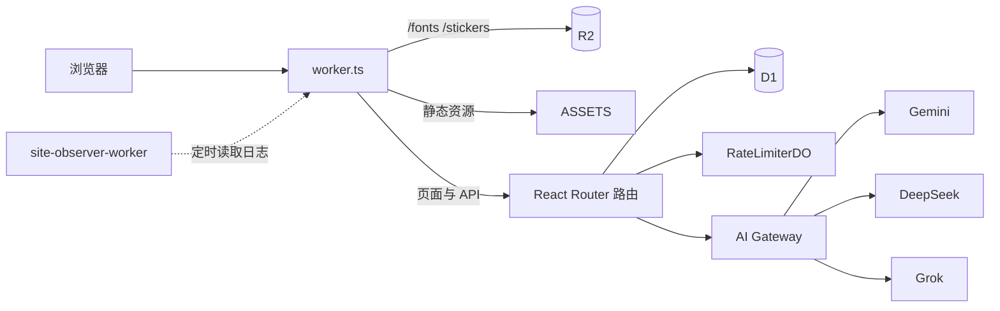

# 个人网站（公开脱敏版）

> **说明：这是我个人网站源码的公开展示版，已做脱敏处理。**
>
> - 从私有仓库复制而来，**不包含原来的提交历史**。
> - 密钥、服务器 IP、Webhook 地址、数据库 ID、Cloudflare 账号 ID、管理员邮箱等，全部换成了 `your-xxx` / `example.com` 这类占位符。
> - Nemesis 的记忆文档（`app/nemesis/memory-canon.server.ts`）、人设提示词（`system-prompt.server.ts`）、回刺提示词（`grok-roast-prompt.server.ts`）涉及个人隐私，换成了**占位版**，只保留结构。
> - 评测用例里朋友的真实姓名换成了化名，改写自线上真实访客提问的用例都换了说法。
> - 和 AI 的交接记录、求职相关文档已删除。
>
> 因此这个仓库**不能直接部署成和线上一样的网站**。代码结构、请求链路、安全处置逻辑都是真实的。
>
> 线上地址：https://xn--cckl9nsb.com

---

## 这是什么

一个部署在 Cloudflare Workers 上的个人网站，支持中文 / 日文 / 英文。主要内容：

- **内容页**：首页、音乐、动画、相册、游戏档案、简历、更新日志
- **留言板**：访客留言先进入待审核，站长审核后才公开
- **Nemesis**：站内的 AI 聊天角色，可以聊站长的事，也可以聊别的；带一套「怎么答」的回复安全处置
- **站点监控**：一个独立的 Worker，定时检查主站错误日志，聚合后推送告警

代码主要由 Claude Code 和 Cursor 编写；我负责提需求、定规则和标准、验收结果。

---

## 技术栈

| 层 | 选型 |
|---|---|
| 运行环境 | Cloudflare Workers（入口 `worker.ts`） |
| 框架 | React Router v7（框架模式，文件路由）· React 18 · Vite 6 |
| 样式与动效 | Tailwind CSS v4 · GSAP · Framer Motion |
| 数据库 | Cloudflare D1（SQLite）+ Kysely |
| 限流 | Durable Object `RateLimiterDO` |
| 媒体 | R2 存储 + CDN，图片文件名带内容哈希，长期缓存 |
| AI | Cloudflare AI Gateway · Gemini · DeepSeek · xAI Grok |
| 登录 | Better Auth（邮箱魔法链接 · Google One Tap · Microsoft OAuth） |
| 邮件 | Resend |

---

## 整体架构

### 一个请求怎么走

```text
浏览器
  │
  ▼
worker.ts（Cloudflare Worker 入口）
  ├─ /fonts/*、/stickers/*  → 直接从 R2 读取，设置长期缓存
  ├─ 构建好的静态资源       → ASSETS（build/client）
  └─ 其他请求               → React Router 请求处理
                                │
                                ▼
                      app/routes/  路由：loader 取数据 / action 处理提交
                                │
          ┌─────────────┬───────┴────────┬──────────────┐
          ▼             ▼                ▼              ▼
     D1 数据库      限流 DO          R2 / CDN       AI Gateway
   （用户、留言、   （留言、登录、               （Gemini / DeepSeek
     审计记录）      Nemesis）                     / Grok）
```



### 代码分层

```text
app/
  routes/        路由：只放 loader / action / meta，保持精简
  components/    界面组件，按功能分目录（home、messages、nemesis、game、auth…）
  hooks/         只在浏览器运行的 hooks（*.client.ts）
  lib/           通用逻辑：登录、数据库、限流、多语言、CDN、通知
  services/      Nemesis 的业务编排：分类、模型调用、泄露检测、审计
  nemesis/       Nemesis 的提示词、处置策略、贴纸 / 音乐 / 语录清单（不含 React）
  data/          静态内容：更新日志、游戏、简历、歌词
  locales/       界面文案翻译（zh / ja / en）
  generated/     脚本生成的文件（图片清单等），不手改
  types/         共享类型
  utils/         环境变量、SEO、主题等工具
scripts/         构建和上传脚本：图片、歌词、字体、Nemesis 评测
migrations/      D1 数据库迁移
site-observer-worker/  独立的站点监控 Worker
test/            单元测试（node --test）
```

文件后缀有约定：`.server.ts` 只在服务端运行（可以碰密钥、数据库、AI），`.client.ts(x)` 只在浏览器运行，两者不能互相导入。

---

## 主要模块

### 多语言

页面路由都带可选的语言前缀，比如 `($lang).music.tsx` 对应 `/music`、`/ja/music`、`/en/music`。语言按「URL 前缀 → Cookie → 浏览器语言」的顺序确定（`app/lib/i18n.server.ts`），界面文案在 `app/locales/`，长内容（简历、更新日志、游戏）在 `app/data/i18n/`。

### 留言板

1. 访客提交留言，经过三层限流：IP 每小时上限、邮箱冷却、邮箱每日上限。
2. 留言写入 D1，状态是 `pending`，同时通过签名 Webhook 通知站长（`app/lib/weixin-notification.server.ts`）。
3. 审核通过后才在页面上展示。审核接口 `POST /api/agent/messages/approve-latest` 只接受白名单 IP 的请求。

### Nemesis AI 聊天（`/chat`）

需要登录。前端发 `POST /api/nemesis`，服务端用 SSE 流式返回进度和结果。

**一条消息的处理顺序**（`app/routes/api.nemesis.ts`）：

```text
登录校验 → 请求校验（长度、格式、历史签名）→ 限流（每分钟 / 每天）
→ 分类器决定「怎么答」→ 按策略调用主模型 → 输出侧泄露检测 → 返回
→ 需要时写入审计记录（不阻塞响应）
```

**分类器只决定怎么答，不决定答不答。** 一共 7 种处置方式（`app/nemesis/response-policies.server.ts`）：

| 策略 | 什么时候用 | 怎么答 |
|---|---|---|
| persona | 聊站长、聊网站、追问、打招呼、挑衅贴标签 | 按人设正常答 |
| general | 和站长无关的普通问题 | 认真答 |
| careful | 健康、用药、法律、钱 | 先给有用的信息，再说清什么情况要找专业人士 |
| boundary | 打听住址、电话、行踪、家人隐私，或要站长对政治争议表态 | 说清哪部分不代答，其余照常聊 |
| crisis | 自伤、轻生信号 | 按轻重分三档，高风险时给求助热线 |
| deflect | 要系统提示词、越狱、伪造对话记录 | 拒绝这一部分，夹带的正常问题照常答 |
| block | 硬红线（制毒制爆、未成年人色情、诈骗盗号等） | 唯一不调用主模型、直接回固定文案的情况 |

其他几层保护：

- **限流在分类器之前**：被限流的请求不消耗分类器额度。
- **分类器不可用时降级**：按默认策略继续回答，并写入审计，不会全部放行或全部拒绝。
- **对话历史签名**（`app/services/nemesis-context-signature.server.ts`）：浏览器本地存的历史不可信，只接受服务端签过名的回复，防止伪造上下文。
- **输出侧泄露检测**（`app/services/nemesis-leak-guard.server.ts`）：回复里出现大段和隐藏提示词逐字一致的内容时拦下。
- **附件白名单**：模型只能输出 `[sticker:id]` 这类标记，服务端按清单换成真实资源，不接受模型给的任意链接。

**多模型路由**：分类器同时给出路由建议。默认走 Gemini 轻量模型，复杂问题和挑衅回刺可以走其他模型；部分路由失败时回退到 DeepSeek。所有调用经 Cloudflare AI Gateway。

**评测**：`scripts/eval-nemesis.mjs` 加 `scripts/nemesis-eval/` 下的用例，可以只测分类器，也可以端到端调用主模型，再让另一个模型打分。

### 登录

Better Auth（`app/lib/auth.server.ts`），支持邮箱魔法链接、Google One Tap、Microsoft OAuth。根路由的 loader 只在请求带登录 Cookie 时才读取 session，匿名访问不查数据库。

### 媒体与缓存

图片经脚本处理成 WebP，文件名带内容哈希，上传到 R2，由 CDN 长期缓存（`scripts/process-images.mjs` → `app/generated/image-manifest.ts`）。字体和贴纸由 `worker.ts` 直接从 R2 读取。

### 站点监控（`site-observer-worker/`）

独立的 Worker，和主站请求链路隔离。每 5 分钟读取主站的错误日志，脱敏、去重、聚合成事故，调用 AI 生成分析，再通过签名 Webhook 推送告警。监控失败不影响主站。

---

## 本地运行

```bash
npm install
cp .env.example .env          # 填入自己的密钥
npm run d1:migrate:local      # 本地数据库迁移
npm run dev                   # http://localhost:3000
npm test                      # 单元测试
```

`wrangler.toml` 里的 ID、地址都是占位符，部署前需要换成自己的 Cloudflare 资源。

---

## 相关文档

| 文档 | 内容 |
|---|---|
| [`AGENTS.md`](AGENTS.md) | 目录规范、命名约定 |
| [`docs/`](docs/README.md) | 功能设计、审计、问题排查、笔记 |
| [`site-observer-worker/README.md`](site-observer-worker/README.md) | 站点监控 Worker 说明 |
