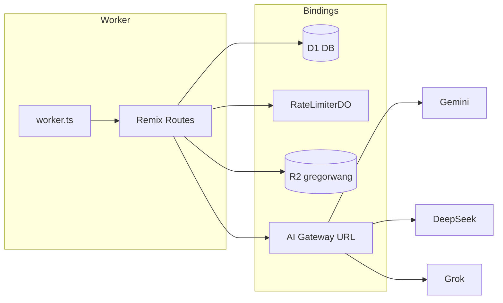

# Remix Cloudflare 个人站点

基于 **Remix v2 + Cloudflare Workers** 的个人网站：多语言首页、内容页、留言板、Nemesis AI 聊天、游戏档案、音乐展示，以及 Better Auth 登录与 D1 持久化。

生产域名示例：`https://xn--cckl9nsb.com`（Worker 名 `my-remix-worker`）。

---

## 技术栈

| 层级 | 选型 |
|------|------|
| Runtime | Cloudflare Workers（`worker.ts` 入口） |
| Web | Remix v2 · React 18 · Vite 6 |
| 样式 | Tailwind CSS v4 · GSAP · Framer Motion |
| 数据库 | Cloudflare D1（SQLite）+ Kysely |
| 限流 | Durable Object `RateLimiterDO`（sqlite-backed，**非 KV**） |
| 媒体 | R2 `gregorwang` · CDN 内容哈希静态图 · Worker 代理 `/fonts/*` `/stickers/*` |
| AI | Cloudflare AI Gateway · Gemini · DeepSeek · xAI Grok |
| 认证 | [better-auth](https://www.better-auth.com/)（魔法链接 · Google One Tap · Microsoft OAuth · Admin 插件） |
| 邮件 | Resend |

Node.js **≥ 20**（见 `.nvmrc`）。

---

## 主要功能

### 内容页面

| 路由 | 说明 |
|------|------|
| `/` | 多语言 Hero、歌词动画、Tab/视频展示、首页留言板预览 |
| `/music` | 音乐展示与 NetEase 风格播放器 |
| `/anime` | 动画相关内容 |
| `/gallery` | 图库 |
| `/cv` | 简历 |
| `/game` · `/game/:platform` | 游戏平台档案（Steam / PS / Switch 等） |
| `/xiao` | 专题图文页 |
| `/updates` | 更新日志（数据源 `app/data/updates.ts`） |
| `/rapid-layers-preview` | 首页视觉实验预览 |

### 留言板

- 首页 `BubbleMessageBoard` + 独立 `/messages` 路由
- 用户提交后进入 **pending** 状态；审核在**独立后台项目**完成（链接由 `ADMIN_MESSAGES_URL` 配置，非本站路由）
- 三层限流：IP 小时上限 · 邮箱冷却 · 邮箱每日上限（留言与魔法链接共用 DO 实现）

### Nemesis AI 聊天（`/chat`）

- 需登录；前端 `NemesisChatPage`，SSE 流式响应（`POST /api/nemesis`）
- 请求链路：登录校验 → 速率限制 → 长度限制 → 硬规则 →（灰区）Gemini JSON 分类 → 模型调用
- 多模型路由：默认 Gemini Lite；规则触发辱骂走 Grok（无 xAI 密钥时 Gemini roast）；失败回退 DeepSeek；全部经 AI Gateway 转发
- 富媒体附件：贴纸、音乐、视频、引用语（catalog 在 `app/nemesis/`）
- 用户反馈：`POST /api/nemesis-feedback`
- 对话状态持久化在浏览器（`app/hooks/useNemesisChat.client.ts`）

### 认证（`/auth`）

- Better Auth 端点：`/api/auth/*`
- 插件：魔法链接、Google One Tap、Microsoft OAuth、Admin 角色
- 登出：`/auth/sign-out`
- 管理员由 `ADMIN_EMAILS`（逗号分隔）判定

### 其他 API

| 端点 | 说明 |
|------|------|
| `POST /api/nemesis` | Nemesis 聊天（SSE） |
| `POST /api/nemesis-feedback` | Nemesis 消息反馈 |
| `GET /sitemap.xml` | 站点地图 |

> **已移除**：旧版 `api.image-token` / `api/media` / `api.verify-token` 签名媒体代理。公开站点图片现走 **CDN 内容哈希 URL**（见下方「媒体与 CDN」）。

---

## 架构概览

```text
Browser
   │
   ▼
worker.ts ──► /fonts/*  /stickers/*  → R2 MEDIA_BUCKET
   │          ASSETS (build/client)   → 静态资源
   │          其余请求                  → Remix request handler
   ▼
app/routes/          薄路由：loader / action / meta
app/components/      UI（按域分子目录）
app/services/        Nemesis 业务编排
app/lib/             通用服务端逻辑（auth、db、限流、CDN 解析）
app/nemesis/         提示词、manifest、catalog（无 React）
app/data/            静态站点内容
app/types/           共享类型
app/hooks/           客户端 hooks（`.client.ts`）
app/generated/       构建产物（image-manifest，勿手改）
```



---

## 快速开始

### 1. 安装依赖

```bash
npm install
```

### 2. 配置环境变量

```bash
cp .env.example .env
```

至少设置：

```env
AUTH_KEY_SECRET=replace_with_a_strong_random_secret
BETTER_AUTH_SECRET=replace_with_a_strong_random_secret
```

完整变量说明见 [`.env.example`](.env.example)。生产密钥通过 Wrangler 注入：

```bash
wrangler secret put AUTH_KEY_SECRET
wrangler secret put GOOGLE_AI_API_KEY
wrangler secret put XAI_API_KEY
# …见 .env.example 注释
```

### 3. 本地 D1 迁移

```bash
npm run d1:migrate:local
```

### 4. 启动开发服务器

```bash
npm run dev
```

默认 **http://localhost:3000**。Vite 配置了 `cloudflareDevProxy`，本地开发时可访问 D1 / R2 / DO / AI 等绑定（与纯前端 dev 不同）。

需要完全模拟生产 Worker 时：

```bash
npm run dev:worker   # build + wrangler dev
# 或
npm run build && npm start
```

### 5. 检查与构建

```bash
npm run typecheck
npm run lint
npm run build
```

Windows 上若 `build/client` 被占用（`EBUSY`），先停止本项目的 dev / workerd 进程再重试。

---

## 常用命令

### 开发与部署

| 命令 | 说明 |
|------|------|
| `npm run dev` | Remix + Vite 开发（端口 3000，含 CF 绑定代理） |
| `npm run build` | 生产构建 → `build/` |
| `npm start` | `wrangler dev`（需先 build） |
| `npm run dev:worker` | build 后 wrangler dev |
| `npm run deploy` | build + 部署到 Cloudflare |
| `npm run cf:login` | Wrangler 登录 |
| `npm run typecheck` | TypeScript 检查 |
| `npm run lint` | ESLint |

### 数据库

| 命令 | 说明 |
|------|------|
| `npm run d1:migrate:local` | 本地 D1 迁移 |
| `npm run d1:migrate:remote` | 远程 D1 迁移 |

### 内容构建流水线

| 命令 | 说明 |
|------|------|
| `npm run lyrics:build` | `assets/lyrics/*.lrc` → `app/data/lyrics/*.json` |
| `npm run images:fetch` | 拉取图片源 |
| `npm run images:process` | 生成 `app/generated/image-manifest.ts` |
| `npm run images:upload` | 上传至 R2 |
| `npm run images:pipeline` | 上述三步串联 |
| `npm run fonts:build` | 字体子集化并准备上传 |
| `npm run stickers:prepare` · `stickers:upload` | Nemesis 贴纸处理与上传 |
| `npm run music:sync` · `music:verify` | Nemesis 音乐 manifest 同步与校验 |

**Changelog**：只编辑 `app/data/updates.ts`；首页 `changelog-section` 自动展示最新 4 条。

---

## 目录结构

```text
app/
  routes/              URL 路由（保持精简，UI 放 components）
  components/
    home/              首页区块
    messages/          BubbleMessageBoard
    nemesis/           Nemesis UI（chat/ 子目录为聊天页）
    game/              游戏页
    auth/              登录相关
    error/             NotFound404、RouteErrorBoundary
    transitions/       全局 RouteTransition
  services/            Nemesis 编排（guard、model、rate-limit、SSE）
  lib/                 auth、db、限流、邮件、CDN 解析等
  nemesis/             提示词、memory canon、manifest、catalog
  data/                updates、game、home-songs、music-showcase、lyrics JSON
  types/               共享领域类型
  hooks/               useNemesisChat 等客户端 hooks
  generated/           image-manifest.ts（构建生成）
  utils/               cloudflare-env、seo、theme、request
assets/                构建源：lyrics、原始图片、字体 OTF
scripts/               构建与上传脚本
migrations/            D1 SQL 迁移
docs/                  项目文档，按类别分子目录（索引见 docs/README.md）
public/                小型静态资源（fonts/、stickers/ 生产走 R2，gitignore）
worker.ts              Worker 入口 + R2 字体/贴纸代理
wrangler.toml          Cloudflare 绑定与 vars
```

命名约定详见 [`AGENTS.md`](AGENTS.md) 与 [`.cursor/rules/layout-and-naming.mdc`](.cursor/rules/layout-and-naming.mdc)。

---

## Cloudflare 绑定

配置见 [`wrangler.toml`](wrangler.toml)：

| 绑定 | 用途 |
|------|------|
| `DB` | D1 `app-db`（用户、会话、留言、Nemesis 审计等） |
| `RATE_LIMITER` | Durable Object 限流 |
| `MEDIA_BUCKET` | R2 `gregorwang` |
| `ASSETS` | `build/client` 静态资源 |
| `AI` | AI Gateway URL 解析（`env.AI.gateway().getUrl()`） |

---

## 认证

- 配置：[`app/lib/auth.server.ts`](app/lib/auth.server.ts)
- 客户端：[`app/lib/auth-client.client.ts`](app/lib/auth-client.client.ts)
- 会话辅助：`getSessionCached` · `requireAuth` · `requireAdmin` · `isAdmin`
- 魔法链接发送走 Resend，并经过与留言板相同的 DO 限流层

---

## 限流

**实现位置**

- 服务层：[`app/lib/rate-limit.server.ts`](app/lib/rate-limit.server.ts)
- DO 实现：[`app/lib/rate-limiter-do.ts`](app/lib/rate-limiter-do.ts)

**使用场景**

- 留言板提交（[`app/routes/messages.tsx`](app/routes/messages.tsx)）
- 魔法链接（[`app/lib/auth.server.ts`](app/lib/auth.server.ts)）
- Nemesis 独立限额（[`app/services/nemesis-rate-limit.server.ts`](app/services/nemesis-rate-limit.server.ts)）

---

## 媒体与 CDN

公开站点图片使用 **内容哈希文件名**，托管于 R2，经 CDN `https://cdn.xn--cckl9nsb.com` 长期缓存（`immutable`）。

- Manifest：[`app/generated/image-manifest.ts`](app/generated/image-manifest.ts)（`npm run images:process` 生成）
- 解析：[`app/lib/resolve-image.ts`](app/lib/resolve-image.ts) · [`app/lib/media-cdn.ts`](app/lib/media-cdn.ts)
- Worker 直出：`/fonts/*`、`/stickers/*` → R2（见 [`worker.ts`](worker.ts)）
- 历史 OSS 资源：`https://oss.xn--cckl9nsb.com`（部分首页资源回退）

详细迁移说明：[`docs/design/image-hash-cdn-migration-2026-06-09.md`](docs/design/image-hash-cdn-migration-2026-06-09.md)

---

## Nemesis 请求顺序（Guard）

修改 Guard 时保持顺序不变；拒绝响应仅返回固定文案，不得泄露分类器原因、提示词、Memory Canon 或 API 密钥。

1. 登录校验
2. 速率限制（分钟 / 日）
3. 输入长度限制
4. 硬规则拦截
5. Gemini JSON 分类器（仅 medium 灰区）
6. 模型选择与调用（经 AI Gateway：Gemini / Grok / DeepSeek）

核心模块：[`app/services/nemesis-guard.server.ts`](app/services/nemesis-guard.server.ts) · [`app/services/nemesis.server.ts`](app/services/nemesis.server.ts) · [`app/nemesis/memory-canon.server.ts`](app/nemesis/memory-canon.server.ts)

---

## 数据库

迁移文件在 [`migrations/`](migrations/)，涵盖：

- Better Auth 表（user / session / account / verification）
- 留言板 messages
- redeem / hidden supply tokens（首页赛博终端的补给 token，0011 已删表）
- Nemesis guard events 与 feedback 审计字段

本地开发 SQLite 文件（`*.db`）已 gitignore。

---

## 部署

```bash
npm run cf:login
npm run deploy
```

部署后建议：

1. `npm run d1:migrate:remote`（如有新迁移）
2. 确认 Wrangler secrets 与 `wrangler.toml` vars 已设置
3. R2 桶 `gregorwang` 存在且 CDN 域名已绑定

---

## 相关文档

| 文档 | 内容 |
|------|------|
| [`AGENTS.md`](AGENTS.md) | 贡献指南、目录规范、调试经验 |
| [`CLAUDE.md`](CLAUDE.md) | AI 助手项目速查 |
| [`CURSOR.md`](CURSOR.md) | Cursor 工作区说明 |
| [`docs/`](docs/README.md) | 功能设计、审计、问题排查、笔记等，按类别分目录 |

---

## 许可证

Private — 个人项目，未开源发布。
