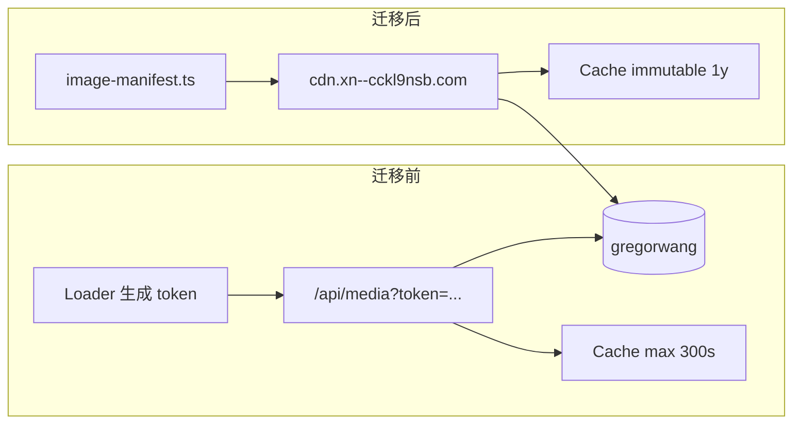

# 图片 Hash + CDN 直链迁移 — Review 文档

> **日期**：2026-06-09  
> **需求来源**：`docs/prompts/image-hash-cache-request-2026-06-09.md`  
> **状态**：已落地；R2 对象已上传；待 `main` 推送后 Workers Builds 自动部署  
> **给 Reviewer**：本文档供其他 AI / 人类做代码与架构审查，覆盖动机、改动面、未改项、运维命令与回滚方式。

---

## 1. 目标与结论（一句话）

将站点图片从 **HMAC Token 网关（`/api/media`，最长 ~5 分钟缓存）** 迁到 **R2 公网自定义域 `cdn.xn--cckl9nsb.com` 直链 + 内容哈希文件名 + `immutable` 一年缓存**；贴纸（`/stickers/*`）管线 **未改动**。

---

## 2. 基础设施事实（审查前必读）

| 项 | 值 |
|----|-----|
| R2 桶名 | `gregorwang`（`wrangler.toml` → `MEDIA_BUCKET`） |
| 公网 CDN 域 | **`https://cdn.xn--cckl9nsb.com`**（绑定 `gregorwang`） |
| 历史首页域 | `https://oss.xn--cckl9nsb.com`（部分音视频仍用；本次 92 张图已迁入 `gregorwang`→`cdn`） |
| Worker 贴纸路由 | `/stickers/*` → R2 `stickers/nemesis/*`，`immutable` 缓存（**保持原样**） |
| 字体路由 | `/fonts/*` → R2 `fonts/*`（**保持原样**） |

**不需要** Worker `/assets/*` 代理路由；R2 自定义域已足够。

---

## 3. 架构变更示意



---

## 4. 新增文件

| 路径 | 作用 |
|------|------|
| `app/lib/media-cdn.ts` | `CDN_BASE` / `OSS_BASE`、`cdnUrl()` / `ossUrl()` |
| `app/lib/resolve-image.ts` | `resolveImage(key)`、`resolveR2Image(r2Key)`，manifest 优先、否则 CDN 直链回退 |
| `app/generated/image-manifest.ts` | **自动生成**，92 条 hash URL + `r2KeyIndex` 旧键映射 |
| `scripts/image-assets.config.mjs` | 资产清单（首页 / gallery / game / music SVG / xiao / cv） |
| `scripts/fetch-image-sources.mjs` | 从 R2（wrangler get）或 oss HTTP 拉到 `assets/images/raw/` |
| `scripts/process-images.mjs` | sharp 转 WebP、sha256 前 8 位、`basename.{hash}.webp`、写 manifest |
| `scripts/upload-public-images.mjs` | `wrangler r2 object put` + `Cache-Control: public, max-age=31536000, immutable` |
| `docs/image-hash-cdn-migration-2026-06-09.md` | 本文档 |

### npm scripts（`package.json`）

```bash
npm run images:fetch      # 拉原图到 assets/images/raw
npm run images:process    # 生成 dist/processed-images + manifest
npm run images:upload     # 上传到 gregorwang
npm run images:pipeline   # 以上三步串联
```

### devDependency

- `sharp` — 图片压缩与 WebP 转换

### `.gitignore` 新增

- `assets/images/raw/`
- `dist/processed-images/`
- `dist/upload-manifest.json`

---

## 5. 删除文件（Token 网关整套移除）

| 路径 | 原作用 |
|------|--------|
| `app/routes/api.media.tsx` | 验签后从 R2 读图，缓存 ≤300s |
| `app/routes/api.image-token.tsx` | POST 生成 token |
| `app/routes/api.verify-token.tsx` | 调试验签 |
| `app/utils/imageToken.server.ts` | HMAC-SHA256 签名 |
| `app/lib/media-token.server.ts` | loader 批量 token 化 |
| `app/lib/token-cache.server.ts` | 内存缓存 token 计算 |

**未删除（易混淆）**

- `app/routes/api.claim-token.tsx` — 留言板「申领 token」彩蛋，与图片无关

---

## 6. 修改文件清单

### 6.1 路由 / Loader（token → CDN）

| 文件 | 变更 |
|------|------|
| `app/routes/gallery.tsx` | `resolveR2Image(img.src)` |
| `app/routes/music.tsx` | `resolveR2Image` 处理 `/SVG/*.jpg` |
| `app/routes/xiao.tsx` | `Feedback/*.webp` → CDN |
| `app/routes/cv.tsx` | 头像 + preload 用 manifest |
| `app/routes/anime.tsx` | `you.mp4` → `cdnUrl("you.mp4")` |
| `app/lib/game-platform.server.ts` | 封面 / 头像 → `resolveR2Image` |

### 6.2 首页组件（硬编码 oss → manifest）

| 文件 | manifest key |
|------|----------------|
| `app/components/photo-section.tsx` | `emt1`, `n4`, `n1`, `n6` |
| `app/components/cyber-terminal.tsx` | `internal_brand_023` |
| `app/components/tab-showcase.tsx` | `asset_85923e7` |
| `app/components/donghua.tsx` | `baiquan` |
| `app/components/video-showcase.tsx` | `asset_cc24ca`（poster）；`yotei.mp4` 仍 `ossUrl` |

### 6.3 SEO / 配置

| 文件 | 变更 |
|------|------|
| `app/utils/seo.ts` | OG 图 `whylookthis` → `cdnUrl("og/....jpg")` |
| `app/routes/_index.tsx` | JSON-LD `avatar` → `cdnUrl("avatar.jpg")` |
| `wrangler.toml` | `IMAGE_BASE_URL` → `https://cdn.xn--cckl9nsb.com` |

---

## 7. Manifest 约定

### 7.1 文件名格式

`{basename}.{sha256前8位}.webp`  
例：`emt1.11330d7a.webp`、`photos/photo-1.9b3079f4.webp`

### 7.2 结构（节选）

```ts
// app/generated/image-manifest.ts — 勿手改
export const IMAGE_CDN_BASE = "https://cdn.xn--cckl9nsb.com";
export const images: Record<string, string> = {
  emt1: "https://cdn.xn--cckl9nsb.com/emt1.11330d7a.webp",
  gallery_photo_1: "https://cdn.xn--cckl9nsb.com/photos/photo-1.9b3079f4.webp",
  // ... 共 92 条
};
export const r2KeyIndex: Record<string, string> = {
  "emt1.webp": "emt1",
  "photos/photo-1.webp": "gallery_photo_1",
  // ...
};
```

### 7.3 页面引用方式

```ts
import { resolveImage } from "~/lib/resolve-image";
import { resolveR2Image } from "~/lib/resolve-image";

// 语义 key（首页等）


// 旧 R2 路径（gallery / game）；自动映射到 hash URL

```

---

## 8. R2 上传与缓存（已完成）

- **桶**：`gregorwang`
- **数量**：92 个 hash 对象（2026-06-09 经 `npm run images:upload`）
- **Cache-Control**：`public, max-age=31536000, immutable`
- **原图**：R2/oss 上的 **非 hash 旧文件未删除**（可回滚）

### 换图运维流程

1. 更新 `assets/images/raw/` 或重新 `images:fetch`
2. `npm run images:process` → 新 hash、更新 manifest
3. `npm run images:upload` → 上传新对象
4. 提交 `app/generated/image-manifest.ts` + 代码改动
5. `git push` → Workers Builds 部署

---

## 9. 明确未改 / 未迁移

| 项 | 说明 |
|----|------|
| Nemesis 贴纸 | `stickers:prepare` / `stickers:upload`、`/stickers/*` Worker 路由、语义 id 命名 |
| `api.claim-token` | 留言板彩蛋 |
| `oss` 音视频 | `yotei.mp4`、`ClariS.mp3`（`home-songs.server.ts`）、`taobao.jfif`（messages） |
| OG 图 hash 化 | `og/*.jpg` 仅改域名为 cdn，**未**走 hash 管线 |
| `rapid-layers-preview` | 未纳入本次 manifest |
| HTML 缓存 | 仍为短缓存 / `no-store`（未改） |

---

## 10. Review 检查清单（给其他 AI）

- [ ] `resolveR2Image` 在 manifest 缺失条目时是否回退到 **无 hash** 的旧 CDN URL（是）
- [ ] 删除 token 后是否还有代码引用 `api/media` / `imageToken`（应无）
- [ ] 贴纸 `/stickers/*` 与 `api.nemesis` 附件管道是否完好（应未动）
- [ ] `image-manifest.ts` 是否与 R2 实际上传对象一致（改图后必须重跑 pipeline）
- [ ] 客户端 bundle 是否意外打进过大 manifest（当前 ~6KB gzip 可接受）
- [ ] `sharp` 仅 devDependency，**不影响** Workers 运行时 bundle
- [ ] 首页 `photo-section` 首图是否考虑 `preload`（可选优化项）

---

## 11. 回滚策略

1. **代码**：`git revert` 本次 commit；恢复 token 相关文件（若需）
2. **流量**：manifest 改回旧 URL 或 `resolveR2Image` 回退路径即旧 CDN 直链（旧对象仍在 R2）
3. **R2**：不删 hash 对象；删不删不影响回滚

---

## 12. 验证命令（审查者本地）

```bash
npm run typecheck
npm run build
npm run lint   # 注：仓库内另有 creative-footer / question 历史 lint

# 抽查 CDN 对象（示例）
curl -I "https://cdn.xn--cckl9nsb.com/emt1.11330d7a.webp"
# 期望：Cache-Control 含 immutable
```

---

## 13. 关联文档

- `docs/prompts/image-hash-cache-request-2026-06-09.md` — 原始需求
- `docs/design/nemesis-rich-media-roadmap-2026-06-08.md` — 贴纸 P1 已上线；与本次正交
- `CLAUDE.md` — 部署后应更新「Secure Media Access」章节（token 段落已过时）

---

## 14. 变更统计（供 PR 描述）

- 删除 ~600 行 token 网关代码
- 新增 ~4 个脚本 + manifest + 2 个 lib 模块
- 92 张图片 WebP hash 化并上传 R2
- 影响路由：gallery、game、music、xiao、cv、anime、首页 5 组件、SEO
