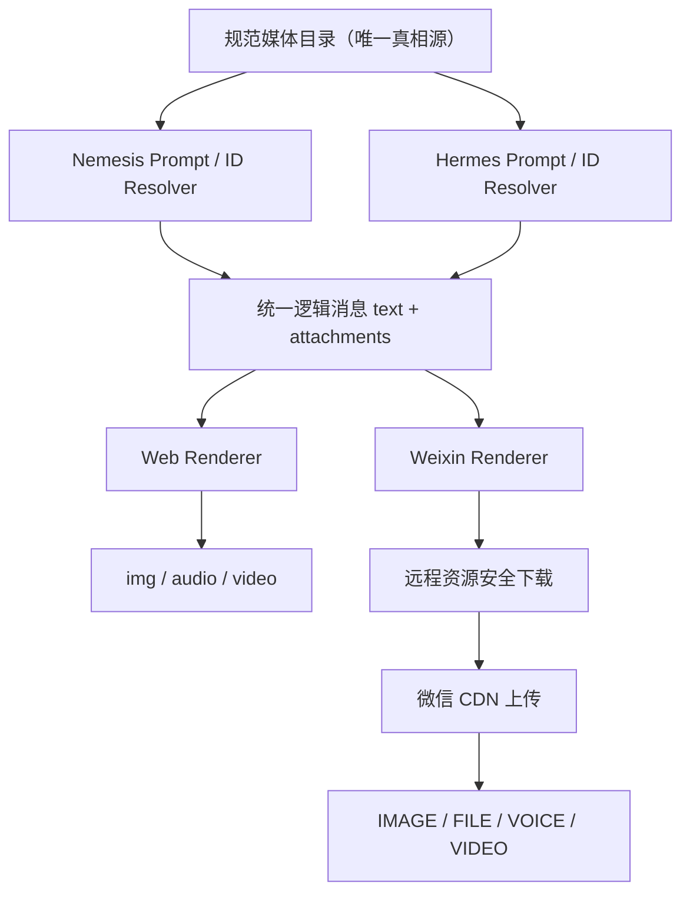

# Nemesis × Hermes × 微信共用图片与音乐融合实施规范

> 日期：2026-07-23
>
> 状态：实施设计稿（尚未改动现有功能代码）
>
> 适用对象：维护个人网站 Nemesis、云服务器 Hermes Agent、微信 iLink 适配层的开发者或开发 AI

## 1. 文档用途

本文件是一次完整的开发交接，不是产品设想摘要。把本文件交给负责云服务器/Hermes/微信适配层的开发 AI 后，它应当能够：

1. 理解现有 Nemesis 图片与音乐的真实实现，而不是把网页 `<audio>` 误认为微信能力。
2. 让 Nemesis 与 Hermes 共用同一套贴纸 ID、曲目 ID、语义与资源元数据。
3. 保留“模型只选择 ID、服务端白名单解析资源”的安全边界。
4. 为 Web 与微信分别实现渠道渲染，不复制两套互相漂移的资产目录。
5. 在微信不支持 HTML 音频播放器和原生音乐卡片的前提下，提供可工作的图片、试听文件、封面、文字和链接降级方案。

一句话目标：

> 以一份规范化媒体目录作为唯一真相源，让 Nemesis Web 和 Hermes 微信入口选择同一批图片与音乐；Web 使用 `/<audio>`，微信适配层负责下载、校验、上传微信 CDN，并映射为 IMAGE、FILE 或实验性 VOICE 消息。

## 2. 范围与非目标

### 2.1 本次要实现

- 共用现有 33 张 Nemesis 贴纸。
- 共用现有 29 首 Apple Music/iTunes 30 秒试听曲目。
- 共用模型指令：`[sticker:id]` 与 `[media:id]`。
- 共用解析、白名单、语义和历史上下文表示。
- Hermes 输出统一的 `text + attachments[]` 逻辑消息。
- 微信侧实现图片与音乐附件渲染、下载上传、失败降级和诊断日志。
- 实验性测试单次 `sendMessage` 的混合 `item_list`，失败时自动拆分。

### 2.2 本次明确不实现

- 不把 React 组件或 HTML `<audio>` 搬进微信。
- 不承诺微信会把多种 `MessageItem` 渲染为同一个视觉气泡。
- 不伪造微信原生音乐卡片；当前公开 iLink 类型没有 `MUSIC`/`AUDIO_CARD`。
- 不开放模型任意输出 URL 后直接下载。
- 不展示模型隐藏思维链。
- 不把完整歌曲默认伪装成微信语音条。
- 不让 Nemesis 和 Hermes 分别手工维护两份贴纸/音乐清单。

## 3. 当前实现事实

### 3.1 唯一真相源

当前仓库中的资产与代码位置：

| 内容 | 当前文件 | 作用 |
|---|---|---|
| 贴纸清单 | `app/nemesis/sticker-manifest.json` | 33 张贴纸的 ID、原始文件名、语义、说明、情绪和动图标记 |
| 贴纸解析 | `app/nemesis/attachment-catalog.server.ts` | 生成文件名、R2 key、公开 URL 和 prompt 附录 |
| 音乐清单 | `app/nemesis/music-manifest.json` | 29 首曲目的 ID、Apple Track ID、试听、封面、页面与语义 |
| 音乐解析 | `app/nemesis/music-catalog.server.ts` | 将曲目 ID 解析为 `AudioAttachment`，生成 prompt 附录 |
| 回复标记解析 | `app/services/nemesis-reply.server.ts` | 删除标记并将最后一个合法贴纸/音乐 ID 转换为附件 |
| 通用附件类型 | `app/types/chat.ts` | `StickerAttachment`、`AudioAttachment`、`VideoAttachment` |
| Web 图片渲染 | `app/components/nemesis/ChatAttachment.tsx` | `` 渲染贴纸 |
| Web 音乐渲染 | `app/components/nemesis/ChatAudioPlayer.client.tsx` | `<audio>` 直接播放 Apple 试听 URL |
| R2 贴纸出口 | `worker.ts` | `/stickers/*` 映射到 `MEDIA_BUCKET` |
| 音乐同步 | `scripts/sync-nemesis-music.mjs` | 通过 iTunes Lookup 更新音乐 manifest；会写文件 |
| 音乐校验 | `scripts/verify-nemesis-music.mjs` | 检查 Lookup、试听 URL、地区与响应内容 |

现阶段应把上述两个 manifest 视为资产目录的规范来源。Hermes 不得自行发明另一套 ID。

### 3.2 当前选择与解析流程

```text
System Prompt 注入贴纸目录与音乐目录
          ↓
模型只输出正文与资源 ID 标记
          ↓
例：[sticker:emt_wink_ok] [media:re0_stay_alive]
          ↓
parseNemesisReply 删除标记
          ↓
服务端根据白名单 ID 解析完整附件对象
          ↓
{ text, attachments[] }
          ↓
Web Renderer / Weixin Renderer 各自渲染
```

当前行为约束：

- 贴纸标记：`[sticker:([a-z0-9_]+)]`，大小写不敏感。
- 音乐标记：`[media:([a-z0-9_]+)]`，大小写不敏感。
- 同类标记出现多个时，只采用最后一个。
- 一次回复最多保留一张贴纸和一首音乐，但二者可以同时存在。
- 无效 ID 被忽略，不允许模型注入 URL。
- 可见正文中不保留这些控制标记。
- 解析后附件顺序为贴纸、音乐，现有代码还支持视频。

### 3.3 网页与微信的关键差异

Web 可以直接执行：

```text
previewUrl → <audio src="..."> → 浏览器下载、解码、播放、显示进度
```

微信 iLink 不执行 HTML。公开消息类型是：

```text
1 TEXT
2 IMAGE
3 VOICE
4 FILE
5 VIDEO
```

所以微信只能执行：

```text
previewUrl
  ↓
适配层下载真实音频字节
  ↓
校验 MIME、大小和来源
  ↓
上传微信 CDN
  ↓
FILE（默认）或 VOICE（实验）
```

`VOICE` 是微信语音留言容器，不是带封面、曲名、歌手和音乐进度条的播放器。

官方协议参考：

- https://github.com/Tencent/openclaw-weixin
- https://github.com/Tencent/openclaw-weixin/blob/main/README.zh_CN.md

## 4. 目标架构



架构必须分成三层：

1. **目录与选择层**：资源 ID、语义、元数据、白名单。
2. **逻辑消息层**：与渠道无关的 `text + attachments[]`。
3. **渠道渲染层**：Web、微信、Telegram 等分别实现。

禁止把微信上传参数、AES key、`context_token` 写回共享媒体目录；这些属于单次渠道投递状态。

## 5. 共用目录的发布策略

### 5.1 推荐方案：生成版本化公共目录

以当前两个 manifest 为输入，生成一个不含密钥的版本化 JSON：

```json
{
  "schemaVersion": 1,
  "catalogVersion": "2026-07-23.1",
  "generatedAt": "2026-07-23T00:00:00Z",
  "stickers": [],
  "music": []
}
```

再通过稳定 HTTPS 地址发布，例如：

```text
https://<个人网站域名>/api/nemesis/media-catalog/v1
```

注意：这个 API 当前尚不存在，上述路径是目标设计，不得在实现前假装它已经可用。

Hermes 的目录客户端应：

- 启动时拉取目录。
- 校验 `schemaVersion`。
- 在内存中建立 `id → entry` Map。
- 使用 ETag 或定时刷新，建议 6 小时。
- 保留最近一次有效目录作为缓存。
- 拉取失败时继续用旧目录，不影响纯文本回复。
- 记录 `catalogVersion`，便于诊断两个系统是否一致。

### 5.2 第一阶段可用方案：构建时同步 manifest

若暂时不新增公共目录 API，可以在部署 Hermes 时复制当前两个 manifest，但必须满足：

- 只从本仓库复制，目标服务器不得手工修改。
- 同时记录源 Git commit 与文件 SHA-256。
- 每次更新资产都重新同步两个文件。
- Hermes 启动日志输出清单版本、贴纸数量和音乐数量。
- 不允许 Nemesis 与 Hermes 分别新增同名不同义的 ID。

### 5.3 目录更新责任

- 贴纸二进制继续由当前 R2 管理。
- 贴纸 ID 与语义只在 `sticker-manifest.json` 修改。
- 音乐 ID、Track ID 与语义只在 `music-manifest.json` 修改。
- Apple 的 `previewUrl` 可能变化；由规范源运行 `npm run music:sync` 更新。
- Hermes 只消费同步结果，不独立改写 Apple URL，避免两个系统漂移。
- `npm run music:sync` 会写 manifest；自动化执行前必须审阅 diff。

## 6. 统一数据契约

### 6.1 目录类型

开发时可以按目标语言等价实现以下 TypeScript 契约：

```ts
type SharedMediaCatalogV1 = {
  schemaVersion: 1;
  catalogVersion: string;
  generatedAt: string;
  stickers: SharedStickerEntryV1[];
  music: SharedMusicEntryV1[];
};

type SharedStickerEntryV1 = {
  type: "sticker";
  id: string;
  semantics: string[];
  alt: string;
  mood: string;
  animated: boolean;
  filename: string;
  mime: "image/webp" | "image/gif";
  publicUrl: string;
};

type SharedMusicEntryV1 = {
  type: "audio";
  id: string;
  source: "apple_music";
  trackId: number;
  lookupCountry: "CN";
  semantics: string[];
  title: string;
  artist: string;
  previewUrl: string;
  artworkUrl: string;
  trackViewUrl: string;
  previewDurationMs: number;
};
```

### 6.2 Agent 逻辑消息类型

模型输出标记解析完成后，Hermes 内部应产生渠道无关对象：

```ts
type OutboundAgentMessage = {
  schemaVersion: 1;
  text: string;
  attachments: Array<StickerAttachmentV1 | AudioAttachmentV1>;
  catalogVersion: string;
  traceId: string;
};

type StickerAttachmentV1 = {
  type: "sticker";
  id: string;
  url: string;
  alt?: string;
  mime: "image/webp" | "image/gif";
};

type AudioAttachmentV1 = {
  type: "audio";
  id: string;
  source: "apple_music";
  title: string;
  artist: string;
  previewUrl: string;
  artworkUrl: string;
  trackViewUrl: string;
  previewDurationMs: number;
};
```

### 6.3 模型与工具资源必须分流

模型文本只能选择目录 ID：

```text
[sticker:emt_wink_ok]
[media:re0_stay_alive]
```

未来若 Hermes 工具生成新图片，必须走可信工具结果对象，而不是让模型在 Markdown 里提供任意 URL：

```ts
type TrustedToolImageAttachment = {
  type: "image";
  origin: "trusted_tool";
  toolCallId: string;
  url: string;
  mime: "image/png" | "image/jpeg" | "image/webp";
};
```

可信工具 URL 也必须经过独立域名白名单、SSRF 防护和内容检查。不得把“模型正文里识别到的第一个 URL”当附件。

## 7. 建议配置清单

以下配置是目标结构。字段名可适配 Hermes 现有配置体系，但语义不得丢失：

```yaml
sharedMedia:
  enabled: true
  schemaVersion: 1

  catalog:
    # phase1: bundled；phase2: remote
    mode: bundled
    stickerManifestPath: "<部署时同步的 sticker-manifest.json>"
    musicManifestPath: "<部署时同步的 music-manifest.json>"
    remoteUrl: "https://<个人网站域名>/api/nemesis/media-catalog/v1"
    refreshSeconds: 21600
    staleIfError: true
    expectedStickerCount: 33
    expectedMusicCount: 29

  selection:
    stickerTagPattern: "\\[sticker:([a-z0-9_]+)\\]"
    musicTagPattern: "\\[media:([a-z0-9_]+)\\]"
    maxStickersPerReply: 1
    maxMusicPerReply: 1
    useLastValidTag: true
    stripControlTagsFromVisibleText: true
    unknownIdPolicy: ignore_and_log
    allowModelProvidedUrls: false

  remoteFetch:
    connectTimeoutMs: 5000
    totalTimeoutMs: 30000
    maxRedirects: 3
    maxImageBytes: 20971520
    maxAudioBytes: 10485760
    blockPrivateNetworks: true
    verifyDnsAfterRedirect: true
    requireHttps: true
    deleteTempFiles: true
    allowedHosts:
      sticker:
        - "xn--cckl9nsb.com"
      musicPreview:
        - "audio-ssl.itunes.apple.com"
      musicArtwork:
        - "*.mzstatic.com"
      musicPage:
        - "music.apple.com"

  weixin:
    typingIndicator: true

    mixedItemList:
      mode: experimental
      fallbackToSplit: true
      preserveLogicalOrder: true

    sticker:
      enabled: true
      uploadAs: image
      onFailure: continue_with_text

    audio:
      enabled: true
      defaultMode: file_with_cover_and_link
      fallbackMode: cover_and_link
      includeArtwork: true
      includeTrackLink: true
      includePreviewFile: true
      voiceModeExperimental: false
      voiceMaxDurationMs: 60000
      voiceCodec: silk
      onFailure: cover_and_link

    diagnostics:
      logProviderResponse: true
      logContentHashes: true
      logFullPrivateContent: false
      logResolvedUrls: redacted
```

配置说明：

- `remoteUrl` 是第二阶段目标，API 未完成前不能启用 `remote`。
- `allowedHosts` 只允许规范目录里的已知来源；重定向后的最终域名也必须重新验证。
- `defaultMode: file_with_cover_and_link` 是当前最可靠的音乐表现，不依赖不存在的微信音乐卡片。
- `voiceModeExperimental` 默认关闭。音乐试听变成语音条不是默认产品行为。
- 大小限制是本系统的防护值，不代表微信官方硬上限；真实上限仍需真机测试。

## 8. Hermes Prompt 配置清单

Hermes 的 system prompt 应注入与 Nemesis 同源的目录摘要，并包含以下规则：

```text
[Shared Sticker Catalog]
如需发表情包，只能在回复末尾单独一行输出 [sticker:贴纸id]。
贴纸 id 必须来自提供的目录，每次最多一张。
不要输出贴纸 URL，不要自行构造 id，不要每条回复都发贴纸。

[Shared Music Catalog]
如需推荐试听，只能在回复末尾单独一行输出 [media:曲目id]。
曲目 id 必须来自提供的目录，每次最多一首。
正文先自然解释推荐原因，再输出标记。
不要输出 previewUrl，不要自行构造音频地址。

一条回复允许同时包含一个 sticker 标记和一个 media 标记。
这些标记是控制指令，不是展示给用户的正文。
```

不要把 33 张贴纸和 29 首音乐的全部长 URL 塞进 prompt。Prompt 只需要 ID、名称与有限语义；真实 URL 由服务端 resolver 保存。

## 9. 解析逻辑清单

Hermes 应实现与当前 Nemesis 一致的纯函数解析器：

1. 接收模型最终可见文本。
2. 收集所有合法 `[sticker:id]`，采用最后一个。
3. 收集所有合法 `[media:id]`，采用最后一个。
4. 使用小写规范化 ID。
5. 从目录 Map 查找 ID。
6. 找不到 ID 时忽略附件并记录结构化警告。
7. 从正文删除所有贴纸与音乐控制标记。
8. 清理标记删除后多余空行。
9. 按贴纸、音乐顺序构造 `attachments[]`。
10. 返回 `text + attachments + catalogVersion + traceId`。

伪代码：

```ts
function parseSharedMediaReply(rawText: string, catalog: CatalogIndex) {
  const stickerId = getLastId(rawText, STICKER_TAG_PATTERN);
  const musicId = getLastId(rawText, MUSIC_TAG_PATTERN);
  const attachments = [];

  if (stickerId) {
    const sticker = catalog.stickers.get(stickerId.toLowerCase());
    if (sticker) attachments.push(toStickerAttachment(sticker));
  }

  if (musicId) {
    const music = catalog.music.get(musicId.toLowerCase());
    if (music) attachments.push(toAudioAttachment(music));
  }

  return {
    text: stripAndNormalizeControlTags(rawText),
    attachments,
    catalogVersion: catalog.version,
  };
}
```

## 10. 微信渠道映射逻辑

### 10.1 贴纸

```text
StickerAttachment.url
  ↓
检查 URL scheme 与最终 host
  ↓
流式下载并限制字节数
  ↓
根据文件签名确认 WebP/GIF，而非只信 Content-Type
  ↓
必要时转换为微信可稳定接受的格式
  ↓
申请微信 CDN 上传参数
  ↓
加密并上传
  ↓
构造 IMAGE MessageItem
```

生产贴纸 URL 规则：

```text
https://xn--cckl9nsb.com/stickers/nemesis/{filename}
```

R2 object key 规则：

```text
stickers/nemesis/{filename}
```

### 10.2 音乐

微信没有 `<audio>`，因此 `AudioAttachment` 必须由 `WeixinRenderer` 转换。

默认 `file_with_cover_and_link`：

```text
artworkUrl
  → 下载、校验、上传为 IMAGE

title + artist + 30 秒说明 + trackViewUrl
  → TEXT

previewUrl
  → 下载音频字节、校验、上传为 FILE
```

建议文本模板：

```text
🎵 {title}
歌手：{artist}
Apple Music 官方 30 秒试听
完整版：{trackViewUrl}
```

`previewUrl` 是实际音频资源，不是歌曲页面；`trackViewUrl` 是 Apple Music 页面，二者不能混用。

### 10.3 实验性 VOICE

仅在明确开启时：

```text
previewUrl
  ↓
下载并探测音频格式/时长
  ↓
FFmpeg 或等价工具解码
  ↓
转为微信所需 SILK
  ↓
使用 VOICE 上传与 MessageItem
```

验收前不得默认启用，原因：

- 语音条没有专辑封面和音乐语义。
- 音乐作为语音留言体验不自然。
- 编码、时长、大小和出站插件支持仍需真机验证。
- 失败时必须自动退回 FILE，再失败则退回封面、文字与链接。

### 10.4 单请求混合 `item_list`

实验目标是让一次逻辑回复只调用一次 `sendMessage`：

```json
{
  "msg": {
    "item_list": [
      { "type": 2, "image_item": "<贴纸或封面>" },
      { "type": 1, "text_item": { "text": "<正文和歌曲信息>" } },
      { "type": 4, "file_item": "<30秒试听文件>" }
    ]
  }
}
```

这只是逻辑示意，真实字段必须以安装版本的腾讯插件类型定义为准。

必须测试：

- `[IMAGE, TEXT]`
- `[TEXT, IMAGE]`
- `[IMAGE, TEXT, FILE]`
- `[IMAGE, IMAGE, TEXT, FILE]`（贴纸与封面并存）
- 短文本与长文本。
- GIF/WebP 与静态封面。
- 服务端接受但客户端拆气泡的情况。

任何混合发送错误都执行拆分降级，不得让正文一起丢失。

### 10.5 拆分降级顺序

如果混合请求不可用，按以下逻辑块顺序发送：

```text
有贴纸：贴纸 IMAGE
正文：TEXT
有音乐：封面 IMAGE
歌曲信息与正式链接：TEXT
试听：FILE（或已启用并成功的 VOICE）
```

同一逻辑消息使用同一个内部 `traceId` 串行排队，避免并发导致顺序错乱。

## 11. 远程媒体安全清单

微信适配层下载任何 CDN 资源前必须完成：

- 只允许 HTTPS。
- 校验初始 host 和每一次重定向后的 host。
- DNS 解析后拒绝 loopback、RFC1918、link-local、组播和云元数据地址。
- 防止 DNS rebinding；连接目标应与已验证结果一致。
- 设置连接超时、总超时和最大重定向次数。
- 使用流式读取并在超过大小上限时立即中断。
- 同时检查响应 `Content-Type`、文件签名和实际可解码性。
- 不把 Cookie、Authorization 或内部请求头转发到第三方 CDN。
- 临时文件名随机化，路径固定在专用临时目录。
- 上传完成或失败后都清理临时文件。
- 日志不记录 AES key、完整 `context_token`、Cookie 或私人消息全文。
- 对 catalog 资源和可信工具资源使用不同 allowlist。
- 绝不执行模型提供的 `file://`、本地路径或 shell 命令。

## 12. 失败降级矩阵

| 失败点 | 用户仍应收到 | 日志动作 |
|---|---|---|
| 目录拉取失败 | 旧缓存或纯文本 | 记录版本、HTTP 状态与 stale fallback |
| 未知贴纸 ID | 正文 | 记录 ID、模型与 traceId，不记录完整 prompt |
| 未知音乐 ID | 正文 | 同上 |
| 贴纸下载失败 | 正文及其他附件 | 记录 host、状态、错误类型 |
| 贴纸上传失败 | 正文及音乐 | 记录 iLink ret/errmsg 与 client_id |
| 封面失败 | 歌曲文字、链接、试听文件 | 记录 artwork 阶段 |
| 试听下载失败 | 封面、歌曲文字和正式链接 | 记录 preview 阶段；下次可刷新目录 |
| VOICE 转码失败 | FILE | 记录 codec、时长与转码退出状态 |
| FILE 上传失败 | 封面、歌曲文字和正式链接 | 记录 upload/send 两个边界 |
| 混合 `item_list` 被拒 | 自动拆分发送 | 记录实验载荷类型顺序与 ret |
| `ret=0` 但手机未送达 | 无可靠自动补救；保留诊断证据 | 记录哈希、时间、message/client/run ID |

媒体失败不得把成功生成的正文变成整轮失败。

## 13. 可观察性字段

每次逻辑回复至少记录：

```text
trace_id
catalog_version
agent_name
channel
model_provider
model_name
text_length
text_sha256
attachment_ids
attachment_types
resolved_hostnames
download_http_status
download_content_type
download_bytes
upload_media_type
weixin_client_id
weixin_run_id
weixin_http_status
weixin_ret
weixin_errmsg
fallback_path
elapsed_ms
```

禁止记录：

- 完整 API key、Bearer token、Cookie。
- AES key 与完整 CDN 加密参数。
- 完整私人对话正文。
- 完整系统提示词或 Memory Canon。

## 14. 多轮上下文规则

历史上下文不应重复放入真实 URL，而应保留语义说明：

```text
[Nemesis/Hermes 发了一张表情包：{alt}]
[Nemesis/Hermes 推了一首歌：{title}]
```

这样可以：

- 让下一轮模型知道刚才已经发过什么。
- 防止模型因为上下文裸链而再次输出 URL。
- 避免 Apple 临时试听链接污染长期历史。
- 保持 Nemesis Web 与 Hermes 微信语义一致。

## 15. 实施逻辑清单

### 阶段 A：目标仓库摸底

- [ ] 找到 Hermes 最终回复对象、渠道适配接口和微信发送入口。
- [ ] 找到腾讯插件实际安装版本及其 `MessageItem`、上传、媒体路由实现。
- [ ] 确认当前是否把 `audio/*` 作为 FILE，以及是否已经支持出站 VOICE。
- [ ] 确认服务器是否安装 FFmpeg；未启用 VOICE 时不是阻塞项。
- [ ] 确认服务器能访问个人网站、Apple CDN 与微信 CDN。
- [ ] 不修改 Nemesis 现有 manifest，先建立只读消费链路。

### 阶段 B：共用目录

- [ ] 先实现 bundled manifest 同步或实现版本化公共目录 API。
- [ ] 建立 `id → entry` Map，并验证 ID 唯一。
- [ ] 校验贴纸数 33、曲目数 29。
- [ ] 校验每张贴纸的公开 URL 可构造。
- [ ] 校验每首音乐必需字段与 `lookupCountry=CN`。
- [ ] 输出 catalog 版本与 hash。

### 阶段 C：模型选择与解析

- [ ] 从同一目录生成 Hermes prompt 附录。
- [ ] 实现 `[sticker:id]` 与 `[media:id]` 解析。
- [ ] 限制每类最多一个并采用最后一个。
- [ ] 删除控制标记并整理空行。
- [ ] 无效 ID 只记录告警，不信任 URL。
- [ ] 将附件语义写入多轮上下文。

### 阶段 D：微信 Renderer

- [ ] 建立 `renderForWeixin(OutboundAgentMessage)`，不要污染 Agent 核心类型。
- [ ] 实现安全远程下载器。
- [ ] 贴纸映射 IMAGE。
- [ ] 音乐默认映射封面 IMAGE、元数据 TEXT、试听 FILE。
- [ ] 实现发送队列与 traceId。
- [ ] 加入实验性混合 `item_list` 开关。
- [ ] 混合失败自动拆分。
- [ ] 媒体失败时保留正文。
- [ ] 可选实现 VOICE/SILK，保持默认关闭。

### 阶段 E：验证与上线

- [ ] 单元测试目录验证、标记解析、URL allowlist 与降级决策。
- [ ] 集成测试 CDN 下载、微信上传和发送响应。
- [ ] 使用测试账号进行真机渲染截图。
- [ ] 验证 Android、iOS 和桌面微信至少两个客户端。
- [ ] 验证内容检测或静默投递不会被误判成模型失败。
- [ ] 先灰度启用一个账号，再扩大范围。

## 16. 验收用例

| 编号 | 模型输出/场景 | 期望结果 |
|---|---|---|
| T01 | 纯文本 | 只发送 TEXT |
| T02 | 正文 + 合法 `[sticker:emt_wink_ok]` | 正文无控制标记，发送对应 IMAGE |
| T03 | 正文 + 合法 `[media:re0_stay_alive]` | 封面、歌曲信息/链接、30 秒试听 FILE |
| T04 | 同时贴纸与音乐 | `attachments[]` 同时包含二者，顺序稳定 |
| T05 | 两个 sticker 标记 | 只采用最后一个 |
| T06 | 未知 sticker/media ID | 只发送正文并记录警告 |
| T07 | 模型输出任意 Markdown 图片 URL | 不自动作为目录附件发送 |
| T08 | 贴纸 URL 302 到内网 | 下载被拒绝，正文继续发送 |
| T09 | Content-Type 声称图片但实际是 HTML | 下载被拒绝，正文继续发送 |
| T10 | Apple preview URL 失效 | 封面、元数据和正式链接仍发送 |
| T11 | 混合 `item_list` 返回非零 ret | 自动拆分，无重复正文 |
| T12 | 混合请求 ret=0 但客户端拆成多个气泡 | 记录为“协议接受/客户端拆分”，不是代码错误 |
| T13 | VOICE 转码失败 | 自动作为 FILE；FILE 再失败则封面+链接 |
| T14 | 同时贴纸、封面和试听 | 串行、顺序不乱、无重复上传 |
| T15 | 目录远程刷新失败 | 使用旧缓存，纯文本和旧资产仍可用 |
| T16 | Hermes 多轮追问“刚才那首歌” | 历史中保留歌曲标题语义，不注入试听裸链 |

## 17. 完整贴纸资产清单

公开 URL：`https://xn--cckl9nsb.com/stickers/nemesis/{文件名}`

R2 key：`stickers/nemesis/{文件名}`

| ID | 文件名 | 情绪 | 动图 | 说明 |
|---|---|---|---:|---|
| `salute_yes` | `salute_yes.webp` | `ack` | 否 | 配有“誓死捍卫师父”文字并敬礼的 Q 版角色；收到、遵命、保证完成任务、听大佬的、誓死捍卫、疯狂点头、明白 |
| `smirk_doraemon` | `smirk_doraemon.webp` | `dry_humor` | 否 | 换了魔性写实假笑表情的哆啦 A 梦；呵呵、懂的都懂、有意思、看破不说破、静静看着你装、意味深长 |
| `emt_surprise` | `emt_surprise.webp` | `emt` | 否 | 双眼发亮、头顶冒出感叹号的 Q 版爱蜜莉雅；哎、大受震撼、发现大事、真的假的、瞳孔地震 |
| `tired_smoke` | `tired_smoke.webp` | `tired` | 否 | 咬着烟、眼神忧郁憔悴的久美子；心累、代码没法写、让我静静、优雅破防、沧桑 |
| `loyal_salute` | `loyal_salute.webp` | `ack` | 否 | 严肃敬礼并高呼“忠诚”的黑发动漫少女；忠诚、坚决执行、收到命令、保证搞定 |
| `stare_blank_cat_loop` | `stare_blank_cat_loop.gif` | `speechless` | 是 | 橘猫死盯镜头并微微晃动；盯着你、暗中观察、目光呆滞、缓缓问号 |
| `roll_sleeves_loop` | `roll_sleeves_loop.gif` | `tech` | 是 | 泉此方自信挽袖准备干活；准备大干一场、开搞、让我来、修 Bug |
| `tease_tongue` | `tease_tongue.webp` | `dry_humor` | 否 | Q 版黑发少女吐舌做鬼脸；略略略、调皮、气不气、抓不到我 |
| `smug_miku_loop` | `smug_miku_loop.gif` | `dry_humor` | 是 | Q 版初音未来托腮并微微晃动；哼哼、计划通、尽在掌握、得意 |
| `maracas_happy_loop` | `maracas_happy_loop.gif` | `laugh` | 是 | 蓝发像素小人快乐摇沙锤；好耶、狂欢、庆祝、奏乐、开心 |
| `confused_ha` | `confused_ha.webp` | `speechless` | 否 | 粉发少女震惊愤怒地喊“哈？”；无法理解、地铁老人手机、你没事吧 |
| `emt_wink_ok` | `emt_wink_ok.webp` | `emt` | 否 | Q 版爱蜜莉雅眨眼并比 OK；没问题、包在我身上、安排、妥了 |
| `brain_tremble` | `brain_tremble.webp` | `speechless` | 否 | 怠惰祭司“大脑在颤抖”表情；CPU 烧了、逻辑崩盘、大受震撼 |
| `emt_pout` | `emt_pout.webp` | `emt` | 否 | Q 版爱蜜莉雅握拳鼓腮；气鼓鼓、傲娇、委屈、不满 |
| `emt_phone_surf` | `emt_phone_surf.webp` | `emt` | 否 | Q 版爱蜜莉雅低头刷手机；吃瓜、围观、网上冲浪、看进展 |
| `side_eye_doge_loop` | `side_eye_doge_loop.gif` | `dry_humor` | 是 | 柴犬眼珠左右横跳；斜眼笑、事情不简单、战术后仰、意味深长 |
| `emt_peek` | `emt_peek.webp` | `emt` | 否 | Q 版爱蜜莉雅扒墙偷看；暗中观察、悄悄路过、冒个头、窥屏 |
| `not_bad_hat` | `not_bad_hat.webp` | `ack` | 否 | 戴斗笠小人配“不赖”；还可以、针不戳、有点东西、过关 |
| `stare_suspicious` | `stare_suspicious.webp` | `dry_humor` | 否 | 白帽男子可疑斜眼；你不对劲、试探边缘、怀疑、这合理吗 |
| `warn_police` | `warn_police.webp` | `reject` | 否 | 卡通警察“上网老实点”；停止危险行为、别搞事、警告 |
| `stare_blank_bocchi` | `stare_blank_bocchi.webp` | `speechless` | 否 | 波奇酱高糊空洞大头；呆滞、沉默、生无可恋、自闭、CPU 烧了 |
| `angry_jerry` | `angry_jerry.webp` | `reject` | 否 | 杰瑞鼠戴白帽并满脸怒火；震怒、翻脸、愤怒谴责、你在教我做事 |
| `smirk_distorted` | `smirk_distorted.webp` | `dry_humor` | 否 | 高糊扭曲眼镜人脸诡异微笑；疯狂暗示、核善微笑、不怀好意 |
| `mock_disdain_loop` | `mock_disdain_loop.gif` | `dry_humor` | 是 | 蓝发少女撇嘴嫌弃；就这、啧啧、冷漠嘲讽、轻蔑 |
| `think_cursed` | `think_cursed.webp` | `think` | 否 | 高糊劣化思考脸；陷入沉思、让我想想、逻辑推导、容我看看 |
| `shout_furious` | `shout_furious.webp` | `reject` | 否 | 劣化动物愤怒咆哮；无能狂怒、瞬间暴怒、大声拒绝、退退退 |
| `ciallo_greet_loop` | `ciallo_greet_loop.gif` | `warm` | 是 | 白发 Q 版少女挥手并带 Ciallo 文字；打招呼、尴尬微笑、冒泡 |
| `fast_typing_jerry_loop` | `fast_typing_jerry_loop.gif` | `tech` | 是 | 杰瑞疯狂敲键盘；光速代码、疯狂输出、紧急修 Bug、开工 |
| `anxious_stare_loop` | `anxious_stare_loop.gif` | `tired` | 是 | 紫发少女满头大汗焦虑凝视；高压运维、Bug、血压、手忙脚乱 |
| `horny_emoji` | `horny_emoji.webp` | `dry_humor` | 否 | 额头写“色”的黄色小人；色色、LSP、好东西、让我看看 |
| `teasing_takagi` | `teasing_takagi.webp` | `dry_humor` | 否 | 高木同学捂嘴狡黠微笑；看穿一切、捉弄、计划通、意味深长 |
| `clueless_wave_loop` | `clueless_wave_loop.gif` | `warm` | 是 | 双马尾少女举手呆萌晃动；不知道、投降、无辜、卖萌 |
| `hyped_determined_loop` | `hyped_determined_loop.gif` | `laugh` | 是 | Q 版少女握拳跳跃；燃起来、决心、开卷、冲锋、全力以赴 |

## 18. 完整音乐资产清单

真实 `previewUrl`、`artworkUrl` 和 `trackViewUrl` 以 `app/nemesis/music-manifest.json` 为准，不在本文复制易变长链接。

| ID | Apple Track ID | 曲名 | 艺术家 | 主要语义 |
|---|---:|---|---|---|
| `key_eternicus` | 1844276892 | エタニクル | VISUAL ARTS / Key & ASCA | Key 社、galgame、泪水、感动、催泪、温柔、好友来访 |
| `key_finisterre` | 1842249315 | フィニステラー | 鈴木このみ & VISUAL ARTS / Key | Key 社、Summer Pockets、夏日、感动、动漫 OP、好友来访 |
| `wuwa_farewell_star` | 1874813114 | 远航星的告别 | 鸣潮先约电台, jixwang, Tarokiki & Emi Evans | 鸣潮、游戏音乐、离别、感动、空灵 |
| `wuwa_daisy_crown` | 1800642240 | Daisy Crown (英文版) | 鸣潮先约电台 & Empty old City | 鸣潮、游戏音乐、英文、空灵 |
| `wuwa_pojian_zhihua` | 1859197675 | 破茧之华 | 鸣潮先约电台 & 莉安Lily | 鸣潮、成长、感动、破茧 |
| `hoyo_da_capo` | 1675280886 | Da Capo | HOYO-MiX | 崩坏 3、毕业、离别、感动、催泪 |
| `deco_monitoring` | 1775600454 | モニタリング | DECO*27 | Vocaloid、洗脑、流行、网络热曲、魔性 |
| `deco_mousou_rengou` | 1147145184 | 妄想感傷代償連盟 | DECO*27 | Vocaloid、妄想、感伤、魔性、动漫 |
| `john_harukaze` | 1492613501 | 春嵐 | john | 日系、R&B、散步、春天、节奏感、非温柔接待 |
| `shallm_nannandesuka` | 1888087502 | 何なんですか? | shallm | J-Pop、清爽、轻松、日常、疗愈、好友来访 |
| `konomi_recollect` | 1891689523 | Recollect | 鈴木このみ & Ashnikko | 铃木木乃美、动漫、燃、英语歌、节奏感 |
| `huang_mangxuan` | 1761516944 | 盲选 | 黄霄雲 | 国语流行、励志、演唱、华语 |
| `opera_il_aurait_suffi` | 1599074579 | Il aurait suffi | Le rouge et le noir | 法语音乐剧、摇滚歌剧、戏剧、古典流行 |
| `rick_never_gonna` | 1559885421 | Never Gonna Give You Up | Rick Astley | 梗、整活、欧美流行、怀旧、恶搞 |
| `wuming_de_ren` | 1800743424 | 无名的人 (Live) | 孙楠 & 陈楚生 | 国语流行、平凡、劳动者、催泪、生活 |
| `halozy_masshirona_yuki` | 1711530148 | Masshirona Yuki (feat. 水瀬ましろ) | Halozy | 东方 Project、同人、日系、雪、Halozy |
| `mili_summoning_101` | 1363759914 | Summoning 101 | Mili | 电子、暗黑、艺术流行、英语、实验 |
| `yinqve_xiaoman` | 1478111630 | 小满 | 音阙诗听 & 王梓钰 | 古风、国语、节气、轻快、华语 |
| `minami_kawaki` | 1725802551 | Kawakiwoameku | Minami | 美波、动漫 OP、日系、感动、燃、难过 |
| `fletcher_suckerpunch` | 1652581140 | Suckerpunch | FLETCHER | 欧美流行、节奏感、能量、英语歌 |
| `konomi_this_game` | 877491568 | This game | Konomi Suzuki | 游戏人生、动漫 OP、铃木木乃美、燃、智斗 |
| `konomi_reweave` | 1766032830 | Reweave | Konomi Suzuki | 铃木木乃美、动漫、燃、日系、英语歌 |
| `re0_long_shot` | 1550230067 | Long shot | Mayu Maeshima | Re:0、动漫 OP、燃、第二季、日系 |
| `miku_ride_conformism` | 1823816311 | Ride on the Conformism | Adeliae & Hatsune Miku | 初音未来、Vocaloid、阿浩、网络热曲、魔性 |
| `re0_redo` | 1107861535 | Redo | Konomi Suzuki | Re:0、动漫 OP、铃木木乃美、燃、第一季 |
| `re0_styx_helix` | 1500537678 | STYX HELIX | MYTH & ROID | Re:0、动漫 ED、催泪、沉静 |
| `re0_stay_alive` | 1140032113 | Stay Alive | エミリア(CV:高橋李依) | Re:0、EMT、爱蜜莉雅、动漫 ED、催泪、温柔、好友来访 |
| `re0_paradisus` | 1225107694 | Paradisus-Paradoxum | MYTH & ROID | Re:0、动漫 OP、燃、第二季 |
| `re0_realize` | 1623739502 | Realize | Konomi Suzuki | Re:0、铃木木乃美、动漫 OP、第二季 |

## 19. 交给开发 AI 的执行指令

可以把以下内容连同本文直接交给负责云服务器代码的 AI：

```text
请完整阅读《Nemesis × Hermes × 微信共用图片与音乐融合实施规范》，然后在云服务器上的 Hermes Agent 与微信适配层仓库中实现。

先只读检查目标仓库，定位：
1. Hermes 最终回答结构；
2. 模型 system prompt 组装位置；
3. 工具/媒体附件事件结构；
4. 微信 sendMessage、CDN 上传和媒体路由代码；
5. 当前腾讯插件版本。

实现必须遵守：
- 现有 Nemesis sticker/music manifest 是唯一真相源；
- 模型只能输出 [sticker:id] 与 [media:id]，不得信任模型 URL；
- Agent 核心输出统一 text + attachments[]；
- Web 与微信使用不同 Renderer；
- 微信没有 HTML <audio>，音乐默认发送封面、文字/链接和试听 FILE；
- VOICE/SILK 仅作为默认关闭的实验功能；
- 所有远程下载必须做 allowlist、SSRF、重定向、MIME、文件签名、大小和超时检查；
- 混合 item_list 必须有 feature flag 和自动拆分降级；
- 媒体失败不得吞掉正文；
- 不输出密钥、完整私人消息、Memory Canon 或内部 prompt 到日志。

按本文阶段 A-E 实施，并补齐 T01-T16 验收用例。不要假设远程 catalog API 已存在；若未实现，先使用带版本/hash 的 bundled manifest 同步。完成后报告修改文件、数据流、配置、测试、真机结果和仍未验证的微信客户端行为。
```

## 20. 完成定义

同时满足以下条件才算融合完成：

- Nemesis 与 Hermes 使用相同的 33 个贴纸 ID 和 29 个音乐 ID。
- 两端资产目录可以证明来自同一版本/hash。
- Hermes 能正确解析贴纸和音乐标记并生成统一附件对象。
- 微信能发送贴纸图片。
- 微信能以封面、元数据/链接和文件形式提供 30 秒试听。
- 混合 `item_list` 成功与否都有真机证据。
- 混合失败时自动拆分，不丢正文、不乱序、不重复。
- URL 安全、媒体限制和临时文件清理均有测试。
- 日志能定位模型、目录、下载、上传、发送和投递边界。
- 文档、配置和代码没有声称微信支持 `<audio>` 或原生音乐卡片。
