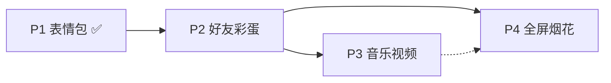

# Nemesis 富媒体与彩蛋 — 后续设计 backlog 摘要

> 整理日期：2026-06-08  
> 状态：**P1 表情包已上线**；其余项暂缓，待更高优先级任务完成后再排期  
> 关联文档：[nemesis-sticker-feature-assessment-2026-06-08.md](./nemesis-sticker-feature-assessment-2026-06-08.md)（贴纸实现定稿与素材规范）

---

## 1. 总览

| 阶段 | 功能 | 状态 | 复杂度 | 性能影响 |
|------|------|------|--------|----------|
| **P1** | AI 语义表情包 | **已上线**（v1.31.0） | 中 | 低（小图 R2 公链） |
| **P2** | 好友 / 节点彩蛋（预设文案 ± 附件） | 未做 | 低～中 | 极低（规则短路，省 token） |
| **P3** | 音乐 / 视频附件 | 未做 | 中 | 中（可控：小 MP3 + 外链视频） |
| **P4** | 全屏粒子烟花等全屏动效彩蛋 | 未做 | 中～中高 | 短时客户端开销（懒加载可控） |

**统一原则（已验证，后续沿用）：**

- 用户侧：**纯文本**，不做多模态识图、不上传。
- AI 侧：只吐 **`id` 标记**（如 `[sticker:id]` / `[media:id]`），由服务端白名单映射 URL；**不让用户点裸链**。
- 资源：**预设库 + 语义目录进 prompt**；公开小文件走 R2 `/stickers/*` 公链，不走 token 网关。
- 彩蛋：**服务端规则表短路**优先于大模型；`user.id` 绑定比「我是某某」文本更稳。

---

## 2. 已完成（P1 表情包）

### 能力

- 33 张贴纸语义目录（`app/nemesis/sticker-manifest.json`）
- 模型 `normal` 模式输出 `[sticker:id]` → `parseNemesisReply` → API `attachments[]`
- 聊天页气泡渲染（打字机结束后出图）
- Worker `/stickers/*` → R2 `gregorwang/stickers/nemesis/`
- 历史上下文占位、复制、反馈、localStorage 兼容

### 关键文件

| 用途 | 路径 |
|------|------|
| 目录与 URL | `app/nemesis/attachment-catalog.server.ts` |
| 回复解析 | `app/services/nemesis-reply.server.ts` |
| 消息格式化 | `app/lib/nemesis-message.ts` |
| API | `app/routes/api.nemesis.ts` |
| 聊天 UI | `app/routes/chat.tsx`、`app/components/ChatAttachment.tsx` |
| R2 脚本 | `scripts/prepare-nemesis-stickers.mjs`、`scripts/upload-nemesis-stickers.mjs` |

### 素材约定

- 静态 → WebP；动图 → GIF（或 optimized WebP）
- 语义 `id` 命名，二进制**不进 Git**，只在 R2
- 静态 ≤80KB，动图 ≤150KB 为宜

---

## 3. 暂缓项设计要点（后续再做）

### P2 — 好友 / 特定节点彩蛋

**目标**：特定人、特定话术触发预设回复（可带贴纸/音乐，不必经过模型）。

**推荐实现：**

```ts
// api.nemesis 内，Guard 之前
const egg = lookupEasterEgg({ userId, message });
if (egg) return json({ text: egg.text, attachments: egg.attachments });
```

| 触发方式 | 可靠性 |
|----------|--------|
| `user.id` / `user.email` | 高，防冒充 |
| 「我是某某」关键词 | 低，仅作补充 |

**复杂度**：约 1～2 天。  
**性能**：无额外负担，反而省 LLM 调用。

---

### P3 — 音乐 / 视频附件

**目标**：与贴纸同构，扩展 `ChatAttachment`：

```ts
| { type: "audio"; id; url; title; cover? }
| { type: "video"; id; url; title; poster? }
```

**模型**：输出 `[media:song_id]`，服务端查媒体目录（同贴纸白名单）。

| 媒体 | 托管建议 | UI |
|------|----------|-----|
| 音乐 | R2 公链 MP3，单文件宜 &lt; 3～5MB | `<audio controls>` 或歌曲卡片 |
| 视频 | **优先 B 站 / YouTube 嵌入**，勿自托管大文件 | `<iframe>` 或封面 + 外链 |

**复杂度**：约 2～4 天（含目录、prompt、播放器 UI）。  
**性能**：贴纸级无压力；注意 MP3 体积与**禁止自动播放**；视频用外链则几乎不占本站带宽。

**不必重做**：`attachments[]` 管道、`parseNemesisReply` 扩展、`MessageContent` 按 type 分支。

---

### P4 — 全屏粒子烟花（高级彩蛋）

**目标**：特定节点全屏动态烟花（Canvas 粒子），与聊天气泡附件**分层**。

**建议架构（与 P2/P3 不同层）：**

```text
彩蛋命中 → { text, attachments?, effect: "fireworks_fullscreen" }
         → 聊天照常渲染 + 懒加载 FireworksOverlay 全屏层
         → 5～15 秒后自动销毁
```

| 方案 | 效果 | 难度 |
|------|------|------|
| canvas-confetti | 纸屑庆祝，非真烟花 | 低 |
| Canvas 2D 粒子（重力、拖尾、二次爆炸） | 接近真实烟花 | 中，3～5 天 MVP |
| WebGL / Three.js | 更炫 | 中高 |

**性能要点：**

- **服务端零影响**；仅触发时客户端运行。
- 懒加载动效代码；粒子数桌面/移动分级；尊重 `prefers-reduced-motion`。
- 播完必须 `cancelAnimationFrame` 并卸载 DOM，避免常驻循环。
- 不适合高频触发；适合「极少、仪式感」节点。

**复杂度**：比 P3 偏前端动效工程，不与贴纸共用 `` 组件。

---

## 4. 推荐排期（恢复开发时）



1. **P2** 若有人际向彩蛋需求，先做（成本低、价值高）。
2. **P3** 在现有 `attachments` 上扩展即可。
3. **P4** 独立组件，可与 P2 组合（同一条彩蛋：文案 + 歌 + 烟花）。

---

## 5. 明确不做（除非产品方向变化）

- 用户发图 / 贴纸面板 / 多模态识图
- AI 生成音乐或视频
- 完整微信级表情商店
- 大视频文件自托管 R2
- 每条消息默认全屏烟花

---

## 6. 恢复开发时的检查清单

- [ ] R2 贴纸公链仍可访问：`/stickers/nemesis/{id}.webp`
- [ ] `npm run deploy` 后 Worker 含 `/stickers/*` 路由
- [ ] 新增媒体时：只改 manifest/目录 + prompt 附录 + R2 上传脚本，**不提交二进制进 Git**
- [ ] 彩蛋表与附件目录分文件维护（如 `nemesis-easter-egg.server.ts`）
- [ ] 全屏动效单独 `effect` 字段，不塞进 `attachments` 的 sticker 类型

---

## 7. 一句话总结

**表情包已经把「附件层」和 R2 公链跑通了**；后续音乐、视频是同一管道的类型扩展；好友彩蛋是 API 前的规则短路；全屏烟花是独立的客户端 `effect` 层。整体都不算架构级大坑，**当前全部暂缓，优先其他任务**；本文档供下次排期时直接对照实现。
