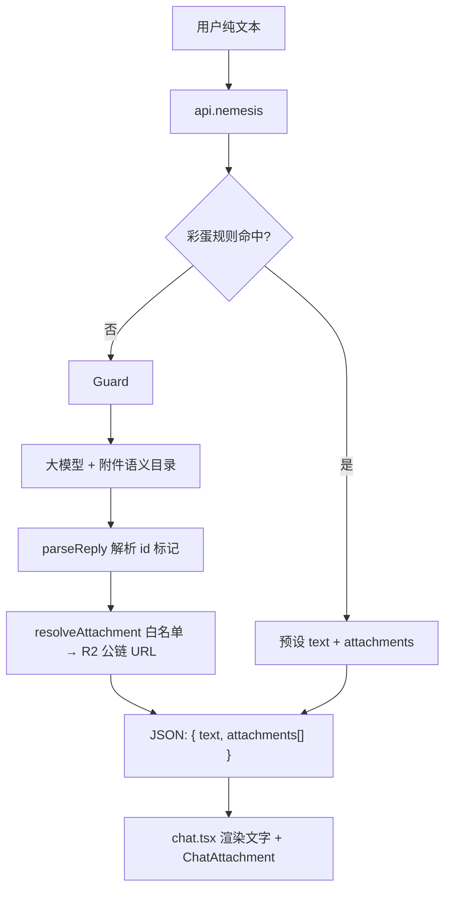
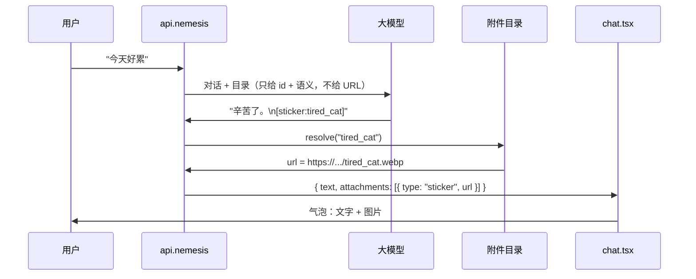

# Nemesis 富媒体附件功能 — 实现定稿

> 定稿日期：2026-06-08  
> 状态：**P1 表情包已上线**（v1.31.0）；P2～P4 见 [nemesis-rich-media-roadmap-2026-06-08.md](./nemesis-rich-media-roadmap-2026-06-08.md)

---

## 1. 已定范围

| 项 | 决定 |
|----|------|
| 用户侧 | **纯文本输入**，不发图，不做多模态识图 |
| AI 侧 | 可发 **表情包 / 音乐 / 视频**（均为预设库，非 AI 生成） |
| 选图逻辑 | **语义映射**：每张资源有 `id` + 语义标签，大模型根据对话输出 `[sticker:id]` / `[media:id]` |
| 资源托管 | **R2 公链直出**，长缓存；**不走** `/api/media` token 网关 |
| 好友彩蛋 | 服务端规则表短路（关键词 / 登录 `user.id`），返回预设 `text + attachments`；不单靠 system prompt |
| 工期预估 | 约 **1～1.5 周**（附件层 + 贴纸 MVP + 彩蛋；音乐/视频 UI 另计 2～4 天） |

**不做**：用户贴纸面板、用户上传、完整微信级表情商店、AI 生成音视频。

---

## 2. 架构与数据流



### 2.1 模型与展示的衔接（不是模态框，是附件层）

一条消息 = **文字 `content`** + 可选 **`attachments[]`**。用户**不点击链接**；气泡内直接展示图/播放器。



| 环节 | 职责 |
|------|------|
| 大模型 | 输出 `[sticker:id]` 或 `[media:id]`，**不输出 URL** |
| 服务端 | 白名单校验 id → 查目录换 R2 公链 |
| 前端 | `` / `<audio>` / `<video>` 画进气泡 |

### 2.2 数据结构

```ts
type ChatAttachment =
  | { type: "sticker"; id: string; url: string; alt?: string }
  | { type: "audio"; id: string; url: string; title: string; cover?: string }
  | { type: "video"; id: string; url: string; title: string; poster?: string };

interface Message {
  id: string;
  role: "user" | "assistant";
  content: string;
  attachments?: ChatAttachment[];
  timestamp: number;
  // 保留现有 status、modelRoute 等字段
}
```

### 2.3 历史上下文

`recentMessages` 仍只传文本。AI 发过贴纸后，占位示例：

```text
[Nemesis 发了一张表情包：无语]
```

不要把 URL 或二进制塞进上下文。

### 2.4 R2 公链

公开贴纸用小文件 + 长缓存，仿 `worker.ts` 的 `/fonts/` 加 `/stickers/*`，或 R2 自定义域名。目录里存最终 URL，**不经过** `imageToken.server.ts`。

### 2.5 好友彩蛋

```ts
// api.nemesis 内，进 Guard 之前
const easterEgg = lookupEasterEgg({ userId: user.id, message });
if (easterEgg) {
  return json({ text: easterEgg.text, attachments: easterEgg.attachments });
}
```

- **登录绑定**（`user.email` / `user.id`）：防冒充，推荐私密话用这个  
- **「我是某某」文本匹配**：可作补充，但可被恶搞  

`api.nemesis.ts` 已有 `user.id / user.email`，目前未传入模型；彩蛋走规则表即可。

### 2.6 与现有功能的兼容

| 功能 | 注意点 |
|------|--------|
| 重新生成 | 基于同一轮 user 文本重试 |
| 复制 | 复制 `content`；有附件时附加 `[表情包: id]` |
| 反馈审计 | 记录 attachment id |
| localStorage | 旧消息仅 `content`，读取时兼容 |
| 打字机 | 仅作用于文字；贴纸在文字显示完后再出 |

---

## 3. 素材库规范（格式与体积）

你当前素材（`photo_020`～`photo_034`）混有 **GIF / WebP / JFIF / PNG**，体积多数在 6～26 KB，但有 outliers：

| 文件 | 格式 | 大小 | 建议 |
|------|------|------|------|
| photo_032 | PNG | **829 KB** | 必须压缩或转 WebP |
| photo_034 | GIF | **340 KB** | 优化帧数/尺寸，或转 animated WebP |
| photo_028 | GIF | **183 KB** | 同上，目标压到 ≤150 KB |
| 其余 WebP/JFIF/GIF | 6～26 KB | ✅ 可保留或统一转 WebP |

### 3.1 要不要统一成一种格式？

**不必强行一种格式打天下**，按「是否动图」分两档即可（浏览器 `` 都支持）：

| 类型 | 推荐格式 | 原因 |
|------|----------|------|
| **静态**表情 | **WebP** | 体积最小，支持透明；比 JFIF/JPEG 更适合贴纸 |
| **动图**表情 | **GIF** 或 **animated WebP** | GIF 兼容性最好；动图 WebP 更小但编码稍麻烦 |

**需要统一的不是文件后缀，而是：**

1. **上传命名**：`stickers/nemesis/{semantic_id}.webp`（不要用 `photo_032` 这种无语义名）  
2. **目录里的 `id`**：与文件名一致，如 `speechless_cat`  
3. **展示尺寸**：源图建议最长边 **240～320px**；聊天气泡 CSS 固定 **120～160px** 宽  
4. **体积上限**（上传 R2 前）：静态 **≤80 KB**，动图 **≤150 KB**（你原目标 100 KB 对动图略紧，GIF 可放宽到 150）

### 3.2 各格式处理建议

| 现格式 | 处理 |
|--------|------|
| **JFIF** | 实为 JPEG，建议 **转 WebP**（质量 80～85），顺便改名 |
| **PNG** | 有透明且静态 → **转 WebP**；`photo_032` 这种 800KB+ 多半是尺寸过大或未压缩 |
| **WebP** | 6～19 KB 的可直接用；确认是否为动图（animated） |
| **GIF** | 能压则压（减帧、缩尺寸、`gifsicle -O3`）；仍超 150 KB 再考虑 animated WebP |

### 3.3 转换工作流（本地一次性）

```bash
# 静态 → WebP（示例，需安装 cwebp / ImageMagick）
cwebp -q 85 input.png -o speechless_cat.webp

# GIF 优化
gifsicle -O3 --colors 128 input.gif -o output.gif
```

上传 R2 路径建议：

```text
stickers/nemesis/speechless_cat.webp
stickers/nemesis/laugh_loop.gif
```

目录 TS 示例：

```ts
{
  id: "speechless_cat",
  type: "sticker",
  semantics: ["无语", "沉默", "……"],
  alt: "无语",
  url: "https://你的域名/stickers/nemesis/speechless_cat.webp",
  mime: "image/webp", // Worker 路由时需要
}
```

### 3.4 模型侧目录写法

System prompt 附录只给 **id + 语义**，不给 URL，例如：

```text
可选表情包（合适时回复末尾单独一行，最多一张）：
speechless_cat：无语、沉默
laugh_loop：哈哈、笑死
不要每条都发。
```

模型输出 `[sticker:speechless_cat]` → 服务端 `resolve` → 非法 id 丢弃。

贴纸总量建议 **20～50 张**，避免 prompt 膨胀。

### 3.5 语义映射与 `id` 命名规则（定稿）

#### 两层数据，不要混为一谈

| 字段 | 给谁用 | 语言 | 示例 |
|------|--------|------|------|
| **`id`** | 文件名、R2 路径、`[sticker:id]`、代码白名单 | **英文 snake_case** | `speechless_cat` |
| **`semantics`** | 写进 system prompt，供聊天模型选图 | **中文短语**（5～8 个） | `["无语", "沉默", "……", "懒得说"]` |
| **`alt`** | 前端无障碍 / 历史占位 | 中文，一句话 | `"无语猫"` |
| **`mood`** | 目录内分类，可选进 prompt | 英文枚举 | `dry_humor` |
| **`animated`** | 决定是否 `.gif` | boolean | `true` |

**你要改文件名的是 `id`，不是把中文语义塞进文件名。**  
`photo_032.png` → 压图后 → `stickers/nemesis/facepalm.webp`；中文语义写在目录 JSON 里。

#### `id` 命名格式

```text
{动作或情绪}_{可选主体}_{可选动图后缀}
```

规则：

1. **全小写英文 + 下划线**，不用中文、空格、连字符  
2. **长度 2～4 段**，总字符 ≤30，如 `nod_ok`、`speechless_cat`、`laugh_loop`  
3. **动图**在 id 末尾加 `_loop` 或 `_gif`，如 `shake_head_loop`（与静态 `shake_head` 区分）  
4. **同一情绪只保留一张首选**；相近图用不同主体区分：`speechless_cat` / `speechless_panda`  
5. **不要用** `photo_020`、`emoji_01`、`img1` 这类无意义名  
6. **EMT / 角色梗**单独前缀，且数量克制（system prompt 要求不滥用）：`emt_nod`、`emt_thanks`  
7. **敏感/攻击性/低潮**类不要进 id 字面（如 `want_to_die`）；用中性动作名：`tired`、`lying_flat`、`stare_blank`

#### 推荐 `mood` 分类（对齐 Nemesis 人格）

来自 `system-prompt.server.ts` / `memory-canon` 的表达谱系，贴纸按类归档，避免 prompt 里 50 张一锅粥：

| `mood` | 适用场景 | id 示例 |
|--------|----------|---------|
| `ack` | 收到、嗯、好的、点头 | `nod_ok`, `thumbs_up` |
| `laugh` | 哈哈、笑死、绷不住 | `laugh_loop`, `lol_cat` |
| `dry_humor` | 冷幽默、反讽、黑色幽默（克制） | `smirk`, `side_eye` |
| `speechless` | 无语、沉默、…… | `speechless_cat`, `dot_dot_dot` |
| `reject` | 不行、算了、摆手 | `wave_no`, `nope` |
| `tired` | 累、躺平、不想动 | `lying_flat`, `exhausted` |
| `think` | 思考、犹豫、等等 | `think_hmm` |
| `warm` | 温和、感谢、安慰（不过度） | `pat_head`, `heart_small` |
| `emt` | EMT 相关，**少量** | `emt_nod`, `emt_sparkle` |
| `tech` | 写代码、bug、部署（可选） | `code_stare`, `bug_squash` |
| `site` | 网站、Nemesis 自嘲（可选） | `nemesis_shrug` |

每类 **2～6 张** 即可；几十张图不必每类都填满。

#### R2 路径与 `id` 对齐

```text
stickers/nemesis/{id}.{ext}

speechless_cat.webp
laugh_loop.gif
emt_nod.webp
```

目录 TS 里 `id` 与文件名（不含扩展名）**必须一致**。

#### 用 Gemini 多模态批量写语义（推荐流程）

**顺序**：先让 Gemini 看图产出元数据 → 你人工过一遍 → 再按 `id` 重命名文件 → 上传 R2 → 写入目录。

1. 本地先把超大图压到规范体积（见 3.2），**暂可保留** `photo_xxx` 原名方便对照  
2. 每次上传 **5～10 张** 给 Gemini（避免单次过多看漏）  
3. 要求 Gemini **只输出 JSON 数组**，便于粘贴进表格  

**给 Gemini 的提示词模板**（附上 Nemesis 人格约束摘要）：

```text
你是 Nemesis 贴纸库的标注助手。宿主说话直、有黑色幽默和冷讽刺，但有边界；
EMT/艾蜜莉雅相关贴纸要克制、尊重，不要轻浮老婆梗；
低潮/自伤类不要做成玩梗素材。

对每张图输出一个 JSON 对象：
- id: 英文 snake_case，2～4 段，动图加 _loop 后缀
- alt: 中文简短描述（≤10字）
- mood: 从 ack|laugh|dry_humor|speechless|reject|tired|think|warm|emt|tech|site 选一个
- semantics: 5～8 个中文短语，描述「什么对话气氛下适合发这张图」
- animated: true/false
- avoid_when: 1～2 个「不宜使用」的场景（中文）

规则：
- 相近情绪优先复用已有 id 模式，不要每张都造新词
- id 不要含敏感字面
- 只输出 JSON 数组，不要 markdown 包裹

已有 id 列表（避免重复）：[粘贴你已确认的 id]
```

4. **人工审核**每张：  
   - id 是否好记、不撞车  
   - semantics 是否太宽（「开心」配所有图）或太窄  
   - `emt` 类是否过多  
5. 按最终 `id` 重命名 + 转格式 → 上传 R2  
6. 汇总进 `attachment-catalog.server.ts`  

#### 目录单条完整示例

```ts
{
  id: "speechless_cat",
  type: "sticker",
  mood: "speechless",
  animated: false,
  alt: "无语猫",
  semantics: ["无语", "沉默", "……", "懒得回", "无话可说", "愣住"],
  avoidWhen: ["用户低落自伤", "严肃技术问答"],
  url: "https://你的域名/stickers/nemesis/speechless_cat.webp",
  mime: "image/webp",
}
```

#### 写进 system prompt 的压缩格式

实现时从目录自动生成，**每条一行**，只给 id + semantics（不给 mood/avoidWhen，省 token）：

```text
speechless_cat：无语、沉默、……、懒得回
laugh_loop：哈哈、笑死、绷不住、太好笑了
emt_nod：嗯、好的、收到（EMT，克制使用，不要频繁）
```

#### 你现在要做的事（P0 清单）

- [ ] 压图 / 转 WebP（见 3.2）  
- [ ] Gemini 批量标注 → 导出 JSON  
- [ ] 人工审核 id + semantics  
- [ ] 文件重命名为 `{id}.webp` / `{id}.gif`  
- [ ] 上传 R2 `stickers/nemesis/`  
- [ ] 写入 `attachment-catalog.server.ts`（实现阶段）

---

## 4. 实现清单

### 4.1 新建

| 文件 | 职责 |
|------|------|
| `app/nemesis/attachment-catalog.server.ts` | 贴纸/音乐/视频目录 + `resolveAttachment(id)` |
| `app/services/nemesis-reply.server.ts` | 解析 `[sticker:]` / `[media:]`，剥离正文 |
| `app/services/nemesis-easter-egg.server.ts` | 好友彩蛋规则表 |
| `app/components/ChatAttachment.tsx` | 按 type 渲染图/音/视频 |

### 4.2 修改

| 文件 | 改动 |
|------|------|
| `app/types/chat.ts` | `attachments?: ChatAttachment[]` |
| `app/routes/api.nemesis.ts` | 彩蛋短路；返回 `attachments`；调用 parse + resolve |
| `app/routes/chat.tsx` | 消费 `attachments`；localStorage 兼容 |
| `app/components/MessageContent.tsx` | 文字 + 委托 `ChatAttachment` |
| `app/nemesis/system-prompt.server.ts` | 附件语义目录附录 |
| `worker.ts`（可选） | `/stickers/*` 公开路由 + `Content-Type` |

### 4.3 分期

| 阶段 | 内容 | 工期 |
|------|------|------|
| **P0** | 素材转码上传 R2 + 目录 JSON/TS | 0.5～1 天 |
| **P1** | 附件层 + AI 贴纸 + 前端渲染 | 3～5 天 |
| **P2** | 好友彩蛋（规则 + 可选登录绑定） | 1～2 天 |
| **P3** | 音乐/视频附件 + 播放器 UI | 2～4 天 |

---

## 5. 风险与约束

- 模型编造不存在的 id → **服务端白名单**，绝不信任模型给的 URL  
- 贴纸发太勤 → prompt 约束 + 可选「每 N 轮最多 1 张」  
- `photo_032` 级大图直接上传 → 拖慢首屏；**必须先压再传**  
- JFIF 后缀不规范 → 统一转 WebP，避免 Worker `Content-Type` 踩坑  
- 彩蛋私密话 → 优先 `user.id` 绑定，文本「我是某某」仅作弱触发  

---

## 6. 一句话总结

**表情包、音乐、视频共用一套 `attachments[]`**：模型只吐 **id**，服务端换 **R2 公链**，前端画进气泡。素材库 **静态用 WebP、动图用 GIF（或 optimized WebP）**，不必一种格式包打天下，但 **必须压掉 800KB 级 PNG、300KB 级 GIF**，并按语义 `id` 命名后再上传。
