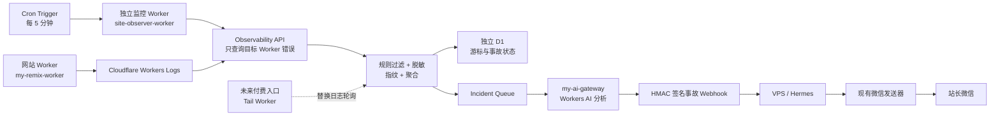

# 网站运行状态感知与 AI 微信事故通知 — 产品功能改进文档

> 日期：2026-07-24
>
> 状态：Cloudflare 侧已部署并运行，VPS/Hermes 接收端待实施
>
> 文档性质：本功能的主产品与实施文档，不是审计报告的补充说明
>
> 适用对象：个人网站维护者、Cloudflare 监控 Worker 开发者、VPS/Hermes/微信适配层开发者或开发 AI

---

## 1. 文档结论

本功能应作为一个新的、可独立部署和停用的监控产品组件实现，暂定服务名：

```text
site-observer-worker
```

它不是当前网站 Worker 中的普通路由，也不是留言通知函数的扩展。完整系统由三个部署边界组成：

1. **网站 Worker：`my-remix-worker`**
   - 继续承载 Remix 网站。
   - 开启 Cloudflare Workers Logs。
   - 后续只在必要位置补充结构化错误事件。
   - 不在用户请求链路中执行日志聚合或 AI 分析。

2. **独立监控 Worker：`site-observer-worker`**
   - 通过 Cron Trigger 定期查询网站 Worker 的 Observability 日志。
   - 执行规则过滤、隐私脱敏、错误指纹、聚合、事故状态管理。
   - 只在新事故或事故升级时，经现有 `my-ai-gateway` 调用 Workers AI。
   - 将 AI 结论与最多 3 条脱敏错误摘录组成同一事故负载。
   - 使用独立签名密钥向 VPS/Hermes 发送事故 Webhook。

3. **VPS/Hermes/微信适配层**
   - 新增网站事故 Webhook 接口。
   - 验证签名、时间戳和幂等请求 ID。
   - 将事故事件转换为适合微信阅读的中文消息。
   - 复用现有微信发送能力，不重新实现微信协议。

一句话目标：

> 让网站在服务端发生真实异常、核心功能连续失败或恢复正常时，系统能够自动聚合证据、生成有置信度的 AI 分析，并通过现有 Hermes 微信链路及时通知站长，同时不拖慢网站本身。

---

## 2. 产品背景

### 2.1 当前问题

当前网站已经具备页面错误展示、部分服务端 `console.error` 和 Cloudflare 指标，但尚未形成主动事故通知闭环。因此可能出现：

- 某个路由或服务端功能持续失败，只有用户反馈后才被发现。
- 第三方服务、D1、Durable Object、AI 模型或通知服务异常，但没有统一入口。
- 同一个错误重复出现很多次，人工查看日志时难以快速判断是否属于同一事故。
- 日志中即使存在堆栈，也缺少“影响范围、可能原因、建议检查项”的中文摘要。
- 网站恢复后没有恢复通知，站长无法确认故障是否已经结束。

### 2.2 当前已有能力

当前仓库已经实现一条独立于邮件的留言微信通知链路：

- 留言写入数据库后调用微信通知发送器。
- Webhook 使用 HTTPS。
- 请求正文使用 HMAC-SHA256 签名。
- 请求包含时间戳、请求 ID 和签名头。
- 微信通知通过 `ExecutionContext.waitUntil()` 后台执行。
- 邮件通知与微信通知互不依赖。

相关实现：

| 能力 | 当前文件 |
|---|---|
| 留言微信 Webhook、HMAC 签名 | `app/lib/weixin-notification.server.ts` |
| 留言保存、微信与邮件分离调度 | `app/lib/messages.server.ts` |
| Worker 环境变量类型 | `app/utils/cloudflare-env.server.ts`、`worker.ts` |
| 生产 Webhook URL 配置 | `wrangler.toml` |

该链路证明“网站 → VPS/Hermes → 微信”的投递方向已经成立，但当前协议固定为：

```text
guestbook.message.created
```

因此本功能只能复用其**签名方式、投递通道和微信发送能力**，不能直接复用留言专用事件名、请求 ID 或消息正文。

截至本文编写时，当前网站 Worker 配置中尚未加入 Workers Logs Observability 配置，也没有 Tail Consumer。VPS/Hermes 接收端位于另一个运行环境，不在本仓库内，因此本文只能确认网站发送端协议，不能假设 VPS 当前使用的框架、持久存储或微信发送函数；VPS 实施必须先检查真实代码。

### 2.3 当前监控盲区

Workers Logs 第一版主要覆盖服务端 Worker，不自动覆盖：

- 浏览器 JavaScript 崩溃。
- 浏览器资源加载失败。
- 用户设备、浏览器兼容性和网络问题。
- 被业务代码捕获后转成 HTTP 200 的“软失败”。
- 业务返回成功状态，但实际外部副作用没有发生的情况。

例如，当前 Nemesis SSE 辅助函数会捕获异常并向前端发送 `error` 事件，但该辅助函数本身没有记录服务端错误日志：

```text
app/lib/nemesis-sse.server.ts
```

因此本功能不能被宣传为“一次实施后知道所有网站故障”。第一版解决服务端事故感知；浏览器错误上报与主动功能巡检应作为后续阶段。

---

## 3. 产品目标与非目标

### 3.1 产品目标

第一版必须实现：

1. 在不引入 Sentry 浏览器 SDK 的前提下，收集网站 Worker 的服务端异常。
2. 在默认情况下，于异常进入 Workers Logs 后 5～10 分钟内发现新事故。
3. 对重复错误进行合并，不按日志条数发送微信。
4. 区分新事故、事故升级和事故恢复。
5. 先用确定性规则判断，再让 AI 生成解释。
6. 即使 AI 不可用，也能发送包含原始事实的降级通知。
7. 复用 VPS/Hermes 的微信发送能力。
8. 不把 AI、VPS Webhook 或日志查询放入网站用户请求链路。
9. 提供每日监控心跳，使站长能够发现“监控系统自己失效”。
10. 可随时停用监控 Worker，而不影响网站正常运行。

### 3.2 明确非目标

第一版不实现：

- 不完整替代 Sentry、Datadog、Grafana 等专业 APM。
- 不采集浏览器端 `window.onerror` 或未处理 Promise 拒绝。
- 不自动修改代码、自动部署或自动回滚。
- 不允许 AI 自主决定执行生产操作。
- 不把每条 `console.error` 都发送到微信。
- 不把完整原始日志、请求头、Cookie、Authorization 或用户内容发送给 AI。
- 不对正常的 401、403、404、405、422、429 逐条告警。
- 不修改现有留言通知的事件语义和用户体验。
- 不直接暴露监控 Worker 的调试或测试入口。

---

## 4. 用户可感知的产品行为

### 4.1 事故生命周期

每个事故具有以下状态：

```text
OPEN → ACTIVE → RECOVERED
```

对应微信事件：

| 事件 | 触发条件 | 微信表现 |
|---|---|---|
| `site.incident.opened` | 首次出现新的高可信错误指纹 | 发送一条新事故通知 |
| `site.incident.updated` | 次数、范围或严重级别明显上升 | 发送一条事故升级通知 |
| `site.incident.recovered` | 在恢复静默窗口内未再次出现 | 发送一条恢复通知 |
| `site.monitor.heartbeat` | 每日固定时间 | 发送监控存活摘要 |
| `site.monitor.degraded` | 日志查询、AI 或投递链路持续异常 | 在仍可用的通道中发送监控降级信息 |

### 4.2 默认严重级别

| 级别 | 含义 | 默认处理 |
|---|---|---|
| `critical` | 网站不可用、资源超限、核心数据库或鉴权大面积失败 | 首个事件立即形成事故 |
| `high` | 核心功能在短时间内重复失败 | 达到阈值后形成事故 |
| `medium` | 第三方依赖或非核心功能连续失败 | 聚合后发送，允许较长冷却 |
| `low` | 单次瞬时异常、影响未知 | 只记录，进入摘要 |
| `info` | 恢复、心跳、部署信息 | 不视为错误 |

建议的第一版默认值：

```text
聚合窗口：5 分钟
查询重叠窗口：10 分钟
事故更新阈值：5、20、100 次
同一事故普通更新冷却：30 分钟
恢复静默窗口：30 分钟
单小时微信事故通知上限：6 条
每日心跳：日本时间 09:00
```

以上均为产品默认值，实施时应通过环境变量配置，不应散落硬编码。

单小时上限只限制普通更新和中低级别通知；新的 `critical` 事故与恢复通知不能被静默丢弃。达到上限时，系统应合并为一条错误风暴摘要，并在 D1 中保留所有事故状态变化。

### 4.3 默认忽略或降级处理

以下事件默认不直接形成事故：

- 正常访问导致的 404。
- 未登录导致的 401。
- 权限拒绝导致的 403。
- 输入校验导致的 400、405、409、422。
- 正常限流产生的 429。
- 用户主动中断请求。
- 已知客户端断开。
- 偶发且未重复的第三方超时。

但如果同一种 401、403、404、429 在短时间内异常激增，可以作为“异常趋势”进入每日摘要，而不是逐条通知。

---

## 5. 目标系统架构



### 5.1 为什么必须是独立 Worker

监控 Worker 必须是独立部署单元，原因如下：

- AI 分析或 VPS 超时不能拖慢网站请求。
- 监控发布失败不能影响网站发布。
- 监控可以单独关闭、回滚和调整频率。
- 监控拥有独立的 Cloudflare API Token、Webhook Secret 和存储。
- 监控 Worker 不应继承网站的登录、数据库和用户隐私权限。
- 以后从免费轮询升级为 Tail Worker 时，不需要重写网站业务。

独立部署意味着至少具有：

```text
独立 Worker 名称
独立 Wrangler 配置
独立版本与部署记录
独立环境变量和 Secrets
独立 D1 数据库
独立 Queue
独立日志与健康状态
```

源代码可以以后决定放在独立仓库，或在明确设计后放入现有仓库的专用位置；本文件不预先发明目录，也不要求现在调整仓库结构。

### 5.2 免费第一版的日志入口

第一版不使用 Tail Worker。原因是 Tail Worker 当前只在 Workers Paid 和 Enterprise 套餐提供。

免费第一版使用：

```text
Cron Trigger
  ↓
POST /accounts/{account_id}/workers/observability/telemetry/query
  ↓
查询最近 10 分钟内属于 my-remix-worker 的错误事件
```

查询条件至少覆盖：

- `$metadata.error EXISTS`
- `$workers.outcome` 表示异常或资源超限
- `$workers.event.response.status >= 500`
- 明确标记为错误级别的结构化自定义日志

查询必须限定：

- 目标服务为 `my-remix-worker`
- 目标环境为 production
- 时间范围窄
- 返回字段最少
- 单次返回量受限
- 必要时使用 `$metadata.id` 游标分页

监控 Worker 绝不能查询并重新处理自己的日志，否则可能形成递归事故。

### 5.3 付费后的升级入口

如果未来升级 Workers Paid，可以将日志入口替换为 Tail Worker：

```text
my-remix-worker
  ↓
Tail Worker events
  ↓
现有过滤、聚合、AI、Webhook 管道
```

Tail Worker 在生产 Worker 执行完成后接收状态、日志和未捕获异常，适合更实时的自定义处理。升级时只替换“日志获取层”，事故模型与 VPS 协议保持不变。

---

## 6. 独立监控 Worker 产品规格

### 6.1 建议绑定与配置

| 类型 | 建议名称 | 用途 |
|---|---|---|
| Worker | `site-observer-worker` | 独立监控服务 |
| Cron | `*/5 * * * *` | 每 5 分钟执行日志查询 |
| D1 | `site-observer-db` | 游标、事故、投递状态 |
| Queue | `site-incident-queue` | 异步分析和 Webhook 投递 |
| DLQ | `site-incident-dlq` | 保存达到最大重试次数的事件 |
| AI binding | `AI` | 生成结构化事故摘要 |
| AI Gateway | `my-ai-gateway` | 统一记录事故分析调用、用量、延迟和错误 |
| Var | `AI_GATEWAY_ID` | `my-ai-gateway` |
| Secret | `CF_OBSERVABILITY_API_TOKEN` | 查询 Workers Observability API |
| Secret | `SITE_INCIDENT_WEBHOOK_SECRET` | 签名事故 Webhook |
| Secret/var | `SITE_INCIDENT_WEBHOOK_URL` | VPS 事故接收地址 |
| Var | `TARGET_WORKER_NAME` | `my-remix-worker` |
| Var | `ENVIRONMENT` | `production` |
| Var | `DELIVERY_ENABLED` | dry-run 与正式发送开关 |

`CF_OBSERVABILITY_API_TOKEN` 必须：

- 使用 API Token，不使用 Global API Key。
- 只绑定当前 Cloudflare 账户。
- 只授予 Observability 查询所需权限。
- 作为 Secret 保存。
- 不打印、不返回、不写入 D1。

当前 Observability 查询 API 使用 `Workers Observability Read` 权限。不要误选 `Workers Observability Telemetry Edit`；后者用于写入遥测，不是本 Worker 查询日志所需权限。

事故分析使用 Cloudflare Workers AI binding，并在 `env.AI.run()` 的 gateway 选项中指定现有 `my-ai-gateway`。因此分析请求会统一出现在该 Gateway 的日志、用量、延迟和错误视图中。

Worker-side AI binding 会在同一 Cloudflare 账户内预认证，不需要复制主站 `CF_AIG_TOKEN`，也不需要模型供应商 API Key。`CF_AIG_TOKEN` 用于从普通 HTTP 客户端访问已认证 Gateway；`CF_OBSERVABILITY_API_TOKEN` 用于查询 Workers Logs，二者仍不能互相替代。

### 6.2 定时查询流程

每次 Cron 执行：

1. 读取上次成功查询水位。
2. 使用“上次水位前 5 分钟”到“当前时间”的重叠窗口查询。
3. 只获取错误候选事件。
4. 验证响应结构和分页游标。
5. 对候选事件执行严格脱敏。
6. 使用 `$metadata.id` 去除重复日志事件。
7. 生成事故指纹。
8. 更新 D1 中的聚合状态。
9. 只有满足打开、升级或恢复条件时才写入 Queue。
10. 成功完成后推进查询水位。

如果 Observability API 查询失败：

- 不推进水位。
- 记录失败次数和最后成功时间。
- 使用指数退避。
- 连续失败达到阈值后，将监控状态标记为 degraded。
- 下次查询继续使用重叠窗口，避免丢事件。

### 6.3 事故指纹

指纹应由稳定、脱敏后的字段生成：

```text
service
environment
route_template
error_name
normalized_error_message
top_normalized_stack_frames
provider_or_dependency
```

规范化必须去掉：

- UUID。
- 数据库自增 ID。
- 时间戳。
- cf-ray。
- 邮箱。
- IP 地址。
- URL 查询参数值。
- 用户提交内容。
- 随机请求 ID。

目标是让相同根因映射到同一指纹，同时避免把两个完全不同的问题错误合并。

### 6.4 D1 事故状态

建议的逻辑数据实体：

| 实体 | 用途 |
|---|---|
| `ingestion_state` | 最后成功水位、最后 API 查询结果 |
| `processed_events` | `$metadata.id` 去重，短期 TTL 清理 |
| `incidents` | 当前事故状态、级别、次数、首次/最后时间 |
| `incident_samples` | 每个事故最多保存少量脱敏样本 |
| `deliveries` | 每次 opened/updated/recovered 的投递状态 |
| `monitor_health` | 日志查询、AI、Queue、Webhook 健康信息 |

建议保留策略：

```text
已处理日志 ID：3 天
脱敏错误样本：7 天
事故记录：90 天
投递记录：30 天
监控健康记录：30 天
```

不要在 D1 中保存完整原始请求头、Cookie、Authorization、聊天输入、留言正文或第三方密钥。

### 6.5 Queue 处理规则

Queue 使用至少一次投递，因此消费者必须幂等：

- 每个事件必须有稳定 `delivery_id`。
- 每条消息单独 `ack` 或 `retry`。
- 一个消息失败不能让整个批次重复。
- HTTP 429、超时和 5xx 允许指数退避重试。
- 数据校验失败、签名配置缺失等永久错误不得无限重试。
- 达到最大重试次数后写入 DLQ。
- DLQ 必须进入监控心跳摘要。

建议 `delivery_id`：

```text
site-incident:{incident_id}:{transition}:{revision}
site-monitor:{heartbeat|degraded}:{period}:{revision}
```

其中 `transition` 只能是 `opened`、`updated` 或 `recovered`。

同一 `delivery_id` 无论被 Queue 或网络重试多少次，VPS 都只能向微信发送一次。

---

## 7. AI 分析规范

日志查询不是每天一次：Cron 每 5 分钟查询一次窄时间窗口。规则层先完成脱敏、去重、指纹和聚合；只有事故达到打开或升级阈值时才调用 AI。每日只额外生成一次监控心跳，不把全天所有日志交给模型。

生产调用路径为：

```text
site-observer-worker
  → env.AI.run(..., { gateway: { id: "my-ai-gateway" } })
  → my-ai-gateway
  → Cloudflare Workers AI
```

Gateway 负责统一记录调用、用量、延迟、缓存状态和错误；Workers AI 模型负责真正生成事故结论。

### 7.1 AI 的职责

AI 只负责：

- 为已确认的事故生成简洁中文标题。
- 根据提供的事实总结最可能原因。
- 标注置信度。
- 列出支持判断的证据。
- 给出人工排查顺序。
- 描述可能影响的功能。

AI 不负责：

- 判断是否需要采集某条原始日志。
- 直接决定事故是否存在。
- 自动执行修复。
- 访问网站用户数据。
- 展示隐藏思维链。
- 将推测写成已经证实的根因。

### 7.2 允许发送给 AI 的输入

```json
{
  "schema_version": 1,
  "service": "my-remix-worker",
  "environment": "production",
  "fingerprint": "sha256:...",
  "severity_candidate": "high",
  "first_seen": "2026-07-24T00:00:00.000Z",
  "last_seen": "2026-07-24T00:05:00.000Z",
  "occurrence_count": 12,
  "outcomes": ["exception"],
  "status_codes": [500],
  "affected_routes": ["/api/nemesis"],
  "exception": {
    "name": "Error",
    "message": "sanitized normalized message",
    "top_stack_frames": ["sanitized frame 1", "sanitized frame 2"]
  },
  "deployment_version": "optional version id",
  "evidence": [
    "12 occurrences in 5 minutes",
    "all samples affect /api/nemesis"
  ]
}
```

最多提供 3 个脱敏样本；禁止把整批原始日志塞入模型。相同的 3 条样本可作为 `error_samples` 随事故负载发送给 VPS，便于微信同时展示 AI 结论和事实摘录。

### 7.3 禁止发送给 AI 的信息

- `Authorization`
- `Cookie` / `Set-Cookie`
- API Key、Secret、Token
- 完整请求头
- 完整 URL 查询字符串
- IP 地址和精确地理信息
- 真实邮箱、用户 ID、用户名
- 留言内容
- Nemesis 用户输入、历史对话、系统提示词
- 第三方服务原始响应中可能包含的凭据

### 7.4 AI 输出契约

AI 必须返回可校验的结构化 JSON：

```json
{
  "title": "Nemesis 对话服务连续失败",
  "summary": "过去 5 分钟内 /api/nemesis 出现 12 次同类异常。",
  "likely_cause": "上游模型请求超时或供应商暂时不可用。",
  "confidence": "medium",
  "user_impact": "用户可能看到 Nemesis 暂时无法响应。",
  "evidence": [
    "异常均发生在同一路由",
    "错误信息表现为上游超时"
  ],
  "recommended_checks": [
    "检查 AI Gateway 与模型供应商状态",
    "查看最近一次部署是否修改了超时配置"
  ]
}
```

`confidence` 只能为：

```text
low | medium | high
```

如果 AI 调用失败、超时、超过免费额度或输出无法校验：

- 不阻止事故通知。
- 使用规则引擎生成的标题和证据作为降级正文。
- 在通知中标明“AI 分析暂不可用”。

---

## 8. 网站事故 Webhook 协议 v1

### 8.1 协议原则

推荐在同一 VPS/Hermes 服务中新建：

```text
POST /webhooks/site-incident
```

不要把事故事件塞进现有：

```text
/webhooks/guestbook-notification
```

原因：

- 两者权限和敏感度不同。
- 两者消息生命周期不同。
- 事故事件需要幂等、升级和恢复语义。
- 新接口可以使用独立密钥。
- 即使监控接口故障，也不应影响留言通知。

本次扩展的是网站与 VPS 之间的内部 Webhook 协议，不需要修改微信 iLink 或其他微信底层协议。

### 8.2 请求头

```http
Content-Type: application/json
X-Request-ID: site-incident:<incident_id>:<transition>:<revision>
X-Webhook-Timestamp: <Unix 秒>
X-Webhook-Signature-V2: <HMAC-SHA256 十六进制小写>
```

监控心跳与监控降级事件使用：

```http
X-Request-ID: site-monitor:<heartbeat|degraded>:<period>:<revision>
```

签名原文必须与现有留言链路保持一致：

```text
{timestamp}.{raw_request_body}
```

签名算法：

```text
HMAC-SHA256(secret, signing_input)
```

VPS 必须使用收到的原始请求字节验签，不能先解析 JSON 再重新序列化后验签。

### 8.3 时间戳与防重放

- 默认允许服务器时间与请求时间相差不超过 300 秒。
- 超出窗口返回 401。
- 签名比较必须使用常量时间比较。
- 不以来源 IP 作为唯一认证方式。
- 请求正文大小上限建议 64 KB。
- 接口只允许 HTTPS。

### 8.4 请求正文

```json
{
  "schema_version": 1,
  "event_type": "site.incident.opened",
  "delivery_id": "site-incident:inc_01:opened:1",
  "emitted_at": "2026-07-24T00:06:00.000Z",
  "incident": {
    "id": "inc_01",
    "fingerprint": "sha256:...",
    "service": "my-remix-worker",
    "environment": "production",
    "severity": "high",
    "status": "open",
    "title": "Nemesis 对话服务连续失败",
    "summary": "过去 5 分钟内出现 12 次同类异常。",
    "likely_cause": "上游模型请求超时或暂时不可用。",
    "confidence": "medium",
    "user_impact": "用户可能无法获得 Nemesis 回复。",
    "evidence": [
      "12 次异常均发生在 /api/nemesis",
      "异常类型和规范化消息一致"
    ],
    "recommended_checks": [
      "检查 AI Gateway 与模型供应商状态",
      "核对最近部署和超时配置"
    ],
    "first_seen": "2026-07-24T00:00:00.000Z",
    "last_seen": "2026-07-24T00:05:00.000Z",
    "occurrence_count": 12,
    "affected_routes": ["/api/nemesis"],
    "status_codes": [500],
    "analysis_source": "workers_ai",
    "error_samples_redacted": true,
    "error_samples": [
      {
        "observed_at": "2026-07-24T00:05:00.000Z",
        "message": "UpstreamError: model request timed out after 20000ms",
        "route": "/api/nemesis",
        "status_code": 500,
        "outcome": "exception",
        "level": "error"
      }
    ],
    "deployment_version": "optional",
    "dashboard_url": "optional Cloudflare dashboard URL"
  }
}
```

`error_samples` 是按时间倒序选取的最多 3 条错误摘录。它们保留原错误类型、脱敏消息、时间、路由、状态码、outcome 和 level，但已经删除或替换邮箱、IP、Cookie、Authorization、API Key、Token、长凭据和 URL 查询参数。`error_samples_redacted` 必须为 `true`。

`site.monitor.heartbeat` 和 `site.monitor.degraded` 使用相同公共信封，但将 `incident` 替换为：

```json
{
  "monitor": {
    "status": "healthy",
    "checked_at": "2026-07-24T00:00:00.000Z",
    "last_log_query_at": "2026-07-24T00:00:00.000Z",
    "open_incident_count": 0,
    "new_incidents_24h": 0,
    "ai_status": "available",
    "webhook_status": "available",
    "dlq_count": 0,
    "degraded_components": [],
    "summary": "网站监控运行正常"
  }
}
```

事故事件必须包含 `incident` 且不包含 `monitor`；监控事件必须包含 `monitor` 且不包含 `incident`。

允许的 `event_type`：

```text
site.incident.opened
site.incident.updated
site.incident.recovered
site.monitor.heartbeat
site.monitor.degraded
```

未知 `schema_version` 或未知事件类型必须返回 400，不能尝试猜测含义。

### 8.5 VPS 响应语义

| 响应 | 含义 | 监控 Worker 行为 |
|---|---|---|
| 200/202 | 已持久接收或已经成功处理 | Queue ack |
| 400 | 协议或字段永久错误 | 不重试，进入 DLQ/人工检查 |
| 401/403 | 时间戳、签名或权限错误 | 不无限重试，立即标记监控配置故障 |
| 409 | 如果用于重复请求，应视为幂等成功 | Queue ack |
| 429 | VPS 限流 | 延迟重试 |
| 5xx | VPS/Hermes/微信链路临时失败 | 指数退避重试 |
| 网络超时 | 未知是否处理成功 | 使用相同 `X-Request-ID` 重试 |

VPS 只有在以下任一条件成立时才能返回 2xx：

1. 事件已经持久写入可靠队列，后续会异步发送微信；或
2. 微信发送已经成功，并且幂等状态已经持久保存。

不能在收到请求后立即返回 2xx，再启动一个没有可靠承诺的后台 Promise。

### 8.6 幂等状态

VPS 必须使用持久存储记录：

```text
delivery_id
event_type
incident_id
payload_hash
state: received | sending | sent | failed
received_at
sent_at
last_error
```

相同 `X-Request-ID`：

- 如果 `payload_hash` 相同且已发送，直接返回幂等成功，不再次发送微信。
- 如果 `payload_hash` 不同，返回 409 或 400，并记录协议冲突。
- 如果先前失败，可继续执行安全重试。

不能只使用进程内 `Set` 或内存缓存做幂等，因为 VPS 进程重启后会丢失。

---

## 9. 微信消息产品格式

### 9.1 新事故

```text
🔴 网站事故 · HIGH

Nemesis 对话服务连续失败
过去 5 分钟内出现 12 次同类异常。

影响：用户可能无法获得 Nemesis 回复
路由：/api/nemesis
首次：2026-07-24 09:00 JST
最近：2026-07-24 09:05 JST
次数：12

可能原因（中等置信度）：
上游模型请求超时或暂时不可用。

证据：
• 12 次异常均发生在同一路由
• 异常类型和规范化消息一致

错误摘录（已脱敏）：
• 09:05 /api/nemesis HTTP 500
  UpstreamError: model request timed out after 20000ms

建议：
1. 检查 AI Gateway 与模型供应商状态
2. 核对最近部署和超时配置

事故 ID：inc_01
```

### 9.2 事故升级

```text
🟠 网站事故升级 · HIGH → CRITICAL

Nemesis 对话服务连续失败
累计次数从 12 增至 100，影响范围扩大。

最近发生：2026-07-24 09:20 JST
事故 ID：inc_01
```

### 9.3 事故恢复

```text
🟢 网站事故已恢复

Nemesis 对话服务连续失败
连续 30 分钟未再次出现。

持续时间：42 分钟
总次数：104
恢复时间：2026-07-24 09:47 JST
事故 ID：inc_01
```

### 9.4 每日心跳

```text
💚 网站监控运行正常

日期：2026-07-24
最近一次日志查询：成功
当前未恢复事故：0
过去 24 小时新事故：0
AI 分析：可用
Webhook / 微信投递：可用
DLQ：0
```

微信正文不得包含：

- 完整堆栈；只允许最多 3 条经过长度限制的脱敏错误摘录。
- Cookie 或 Authorization。
- 用户聊天、留言或邮箱。
- 完整请求 URL 查询参数。
- Cloudflare API Token 或 Webhook Secret。

---

## 10. 网站侧、监控 Worker 与 VPS 的职责边界

| 能力 | 网站仓库 | 独立监控 Worker | VPS/Hermes |
|---|---:|---:|---:|
| 开启 Workers Logs | 负责 | 不负责 | 不负责 |
| 产生结构化服务端错误 | 负责 | 不负责 | 不负责 |
| 查询 Observability API | 不负责 | 负责 | 不负责 |
| 日志脱敏 | 日志源头做第一层 | 做强制第二层 | 做最后输出保护 |
| 错误指纹与聚合 | 不负责 | 负责 | 不负责 |
| AI 事故分析 | 不负责 | 负责 | 不负责 |
| 事故状态 | 不负责 | D1 为唯一真相源 | 只保存投递状态 |
| Webhook 签名 | 留言链路已有自己的签名 | 使用事故专用密钥签名 | 验签 |
| Webhook 幂等 | 不负责 | 生成稳定 delivery ID | 持久去重 |
| 微信格式化与发送 | 不负责 | 发送结构化事故对象 | 负责 |
| 留言通知 | 保持现状 | 不接触 | 保持现状 |
| 监控心跳 | 不负责 | 生成 | 发送微信 |

---

## 11. 性能、费用与套餐边界

以下信息按 2026-07-24 Cloudflare 官方文档核对，实施前仍需再次确认。

### 11.1 Workers Logs

- Free 计划包含每天 200,000 个日志事件。
- Free 保留 3 天。
- 日志包括 invocation logs、自定义日志、错误和未捕获异常。
- 当前网站配置使用 `run_worker_first = true`，因此普通请求日志可能成为主要日志量。

第一版建议：

1. 先以完整采样运行 24～72 小时。
2. 观察真实日志量和错误覆盖。
3. 再决定是否减少普通 invocation logs。
4. 不应为了省日志而轻易采样掉低频但严重的异常。

### 11.2 独立 Worker

- Free Worker 每日请求额度和单次 CPU 限制适用。
- Free 单次 CPU 时间目前为 10 ms；等待网络、D1 和 AI 响应不计入 CPU 时间，但 JSON 解析、归一化和批量处理会计入。
- 因此免费版必须使用服务端过滤、窄时间窗口、少量字段和有限样本。
- 如果日志量增大或持续触发 CPU 超限，应升级 Workers Paid，而不是静默丢弃错误。

### 11.3 Queues

- Free 计划每天包含 10,000 次操作。
- 通常一条成功投递消息约产生写、读、删三次操作。
- Free 消息保留 24 小时。
- 本产品只向 Queue 写入事故状态变化，不写入每条日志，因此个人网站通常有足够余量。

### 11.4 D1

- Free 计划当前包含每天 500 万行读取、10 万行写入和 5 GB 总存储。
- 本产品必须建立索引并定期删除短期去重数据，避免全表扫描。

### 11.5 Workers AI

- 当前每日包含 10,000 Neurons 免费分配。
- 只在事故打开或显著升级时调用；恢复通知复用已保存的分析。
- 选择实施时仍在支持列表中的小型中文可用指令模型。
- 不在文档中固定某个可能被下线的模型名。
- 超出额度或模型不可用时必须退化为规则摘要。
- 请求经现有 `my-ai-gateway` 进入 Workers AI，便于统一查看调用、Token 用量、延迟和失败。

### 11.6 Tail Worker

- Tail Worker 只支持 Workers Paid 和 Enterprise。
- 它在生产 Worker 调用结束后接收执行信息，不需要进入用户响应链路。
- 未来升级 Tail Worker 时，应保留本文件定义的事故状态和 VPS 协议。

官方参考：

- [Workers Logs](https://developers.cloudflare.com/workers/observability/logs/workers-logs/)
- [Observability Query API](https://developers.cloudflare.com/api/resources/workers/subresources/observability/subresources/telemetry/methods/query/)
- [Workers Limits](https://developers.cloudflare.com/workers/platform/limits/)
- [Tail Workers](https://developers.cloudflare.com/workers/observability/logs/tail-workers/)
- [Queues Pricing](https://developers.cloudflare.com/workers/platform/pricing/#queues)
- [D1 Pricing](https://developers.cloudflare.com/d1/platform/pricing/)
- [Workers AI Pricing](https://developers.cloudflare.com/workers-ai/platform/pricing/)
- [Workers AI through AI Gateway binding](https://developers.cloudflare.com/ai-gateway/integrations/aig-workers-ai-binding/)
- [AI Gateway Worker binding methods](https://developers.cloudflare.com/ai-gateway/usage/worker-binding-methods/)

---

## 12. 安全与隐私要求

### 12.1 日志源头

- 服务端日志使用结构化字段，不拼接用户内容。
- 不记录 Cookie、Authorization、OAuth code、Magic Link token。
- 不记录完整 Nemesis prompt 或历史消息。
- 第三方错误只保留状态、错误名和脱敏消息。

### 12.2 监控 Worker

- 不调用或依赖任何“获取未脱敏请求头”的能力。
- URL 只保留 origin 和规范化 pathname。
- 查询参数只允许保留键名白名单，默认删除全部值。
- AI 输入在进入模型前再次扫描敏感字段。
- 只有完成脱敏后的事故证据才允许进入 `my-ai-gateway` 持久日志。
- D1 只保存脱敏样本。
- Webhook 的 `error_samples` 在发送前再次执行脱敏和长度限制。
- 监控 Worker 不提供公开查询事故数据的接口。

### 12.3 VPS

- 必须限制请求体大小。
- 必须验证 HMAC 和时间窗口。
- 必须持久化幂等状态。
- 必须限制日志输出，不能打印完整正文和签名。
- 必须使用事故专用密钥，不能与留言通知密钥共用。
- 密钥轮换时应支持短期双密钥验证窗口，但发送端只能使用当前密钥。

---

## 13. 失败与降级策略

| 失败位置 | 系统行为 |
|---|---|
| Observability API 超时 | 不推进水位，下次重叠查询 |
| API Token 失效 | 标记监控 degraded，记录安全错误 |
| D1 暂时失败 | 不提交新水位，不丢弃候选事件 |
| Queue 写入失败 | 保留事故 revision 为待投递 |
| AI 超时或配额耗尽 | 使用确定性摘要继续通知 |
| VPS 返回 429/5xx | Queue 指数退避 |
| VPS 返回 401/403 | 停止无限重试，标记密钥/时间配置故障 |
| 微信发送失败 | VPS 返回非 2xx 或保留可靠任务，触发重试 |
| 重复 Cron | 通过查询水位、事件 ID 和 delivery ID 幂等 |
| 监控 Worker 自身异常 | 不查询自身日志；依靠每日心跳缺失和 Cloudflare 控制台发现 |

监控系统永远不能把“通知失败”误报成“网站已恢复”。

---

## 14. 部署顺序

### 阶段 0：冻结协议

- [ ] 确认使用独立接口 `/webhooks/site-incident`。
- [ ] 确认 v1 事件类型和请求正文。
- [ ] 生成独立 `SITE_INCIDENT_WEBHOOK_SECRET`。
- [ ] 决定事故状态和投递幂等保留时间。

### 阶段 1：先部署 VPS/Hermes 接收端

- [ ] 新增事故 Webhook，不修改留言 Webhook 行为。
- [ ] 完成原始正文验签、时间窗口和持久幂等。
- [ ] 接入现有微信发送器。
- [ ] 使用本地签名测试载荷验证 opened/updated/recovered。
- [ ] 验证重复请求不会重复发送微信。

### 阶段 2：创建独立监控 Worker

- [x] 建立独立 Worker 工程和 Wrangler 配置。
- [x] 创建独立 D1、Queue 和 DLQ。
- [x] 配置 Workers AI binding。
- [x] 配置受限 Observability API Token。
- [x] 先以 `DELIVERY_ENABLED=false` 部署。
- [x] 验证 Cron、查询、脱敏、聚合和事故状态。

### 阶段 3：网站开启 Workers Logs

- [x] 在网站 Worker 配置中开启 Observability Logs。
- [x] 部署网站 Worker。
- [ ] 观察 24～72 小时日志量。
- [ ] 建立 Dashboard 保存查询。
- [x] 验证异常、5xx 和资源超限能够被查询。

### 阶段 4：联调与启用

- [ ] 使用专用测试事件，不使用真实用户内容。
- [ ] 验证 Cloudflare → Queue → AI → VPS → 微信。
- [ ] 验证 AI 不可用时的降级通知。
- [ ] 验证重复、超时、签名错误和 VPS 5xx。
- [x] 打开 `DELIVERY_ENABLED=true`。
- [ ] 验证每日心跳。

### 阶段 5：补充服务端软失败事件

- [ ] 盘点被 catch 后返回 200 的核心功能。
- [ ] 为这些位置增加统一结构化错误事件。
- [ ] 优先覆盖 Nemesis SSE、鉴权、D1、邮件、留言微信通知。
- [ ] 不把用户内容写入日志。

### 阶段 6：未来增强

- [ ] 浏览器端轻量错误上报。
- [ ] 主动巡检登录、留言、Nemesis 等核心流程。
- [ ] 付费后切换 Tail Worker。
- [ ] 增加事故静默、人工确认和部署关联能力。

---

## 15. 回滚方案

本功能的回滚不得影响网站：

1. 将监控 Worker 的 `DELIVERY_ENABLED` 关闭。
2. 暂停或删除 Cron Trigger。
3. 暂停 Queue consumer。
4. 保留 D1 事故数据，不做破坏性删除。
5. VPS 暂停 `/webhooks/site-incident`，留言接口继续运行。
6. 如 Workers Logs 产生无法接受的额度问题，再单独调整网站 Observability 配置。

禁止通过回滚本功能去回滚网站业务版本。

---

## 16. 验收用例

| 编号 | 场景 | 预期 |
|---|---|---|
| T01 | 合法签名的 `site.incident.opened` | VPS 只发送一条新事故微信 |
| T02 | 相同 `X-Request-ID` 重放 3 次 | 只发送一次微信，其余幂等成功 |
| T03 | 签名错误 | VPS 返回 401，不发送微信 |
| T04 | 时间戳超过 300 秒 | VPS 返回 401，不发送微信 |
| T05 | 同一指纹 20 次 | 聚合为一个事故，不发送 20 条消息 |
| T06 | 普通 404 | 不形成即时事故 |
| T07 | Worker outcome 为 exception | 在一个查询周期内形成候选事故 |
| T08 | AI 返回非法 JSON | 使用确定性摘要发送 |
| T09 | AI 超时或配额耗尽 | 不丢事故，通知标记 AI 不可用 |
| T10 | VPS 第一次返回 500 | Queue 使用相同 delivery ID 重试 |
| T11 | 微信已发送但响应丢失 | VPS 幂等状态阻止重复发送 |
| T12 | 事故 30 分钟未再出现 | 只发送一次 recovered |
| T13 | 原始日志包含 Cookie/邮箱/IP | AI、D1 和微信均看不到这些值 |
| T14 | 监控 Worker 自己报错 | 不被自身日志查询形成递归事故 |
| T15 | 每日心跳 | 微信收到一条简洁健康摘要 |
| T16 | DLQ 有消息 | 下一次心跳明确报告 DLQ 数量 |
| T17 | 原留言通知 | 行为与实施前完全一致 |
| T18 | 关闭监控 Worker | 网站仍能正常访问和使用 |
| T19 | 事故触发 AI 分析 | `my-ai-gateway` 中出现带 `site-observer` 元数据的调用 |
| T20 | 事故包含多条日志 | 微信只展示最多 3 条脱敏错误摘录和 AI 结论 |

---

## 17. 上线判定

只有同时满足以下条件才可以宣告第一版上线：

- Workers Logs 已启用并能在 Dashboard 查询。
- 监控 Worker 连续 24 小时 Cron 成功率满足预期。
- 没有原始敏感信息进入 AI、D1 或微信。
- opened、updated、recovered 均通过真链路测试。
- 重复 Webhook 不会重复发微信。
- AI 不可用时仍有可读通知。
- VPS 失败会被 Queue 重试。
- 留言通知链路没有回归。
- 每日心跳已实际送达。
- 文档记录了所有 Secret 名称，但没有记录 Secret 值。

---

## 18. 交给 VPS/Hermes 开发 AI 的完整提示词

以下内容可以在进入 VPS/Hermes 仓库后直接交给负责实施的开发 AI。执行前应把本文件一并提供给它。

> 本节保留的是实施前的原始交接提示词，其中“尚未写入 Secret”和
> `DELIVERY_ENABLED=false` 是当时快照；当前生产事实以第 19 节为准。

```text
你现在位于承载 Hermes Agent 与微信适配层的 VPS 项目中。请完整阅读随附的《网站运行状态感知与 AI 微信事故通知 — 产品功能改进文档》，然后实现 VPS/Hermes 侧的网站事故 Webhook 接收与微信投递能力。

这是生产功能实施，不是概念演示。请先检查当前仓库、运行方式和现有留言通知链路，再修改代码。不要假设框架、数据库、队列、进程管理器或微信发送函数的名字。

已知上游事实：

1. 个人网站已有一个留言通知 Webhook，事件为 `guestbook.message.created`。
2. 网站发送端目前使用以下签名协议：
   - `X-Request-ID`
   - `X-Webhook-Timestamp`
   - `X-Webhook-Signature-V2`
   - 签名原文为 `${timestamp}.${rawBody}`
   - 算法为 HMAC-SHA256
   - 签名输出为小写十六进制
3. 新能力来自独立 Cloudflare Worker，不来自邮件链路。
4. AI 分析已经由 Cloudflare 监控 Worker 完成；VPS 不需要再次调用 AI。
5. VPS 需要复用现有 Hermes/微信发送能力，不重新发明微信底层协议。
6. Cloudflare 发送端已经部署为 `site-observer-worker`，但当前 `DELIVERY_ENABLED=false`，所以在 VPS 完成之前不会发出真实 Webhook。
7. Cloudflare 端尚未写入 `SITE_INCIDENT_WEBHOOK_URL` 和 `SITE_INCIDENT_WEBHOOK_SECRET`；完成后必须在最终报告中给出公开 HTTPS 接口地址，并说明如何安全地把同一份 Secret 交给 Cloudflare 端，禁止把 Secret 写入仓库或普通日志。
8. Cloudflare 每 5 分钟查询一次日志；达到事故阈值后，经现有 `my-ai-gateway` 调用 Workers AI。事故负载会同时包含 AI 结论和最多 3 条已经脱敏的原始错误摘录。

实施目标：

一、检查现有实现

- 找到 `/webhooks/guestbook-notification` 或等价留言通知入口。
- 找到原始请求正文读取、HMAC 验签、时间戳校验代码。
- 找到 Hermes 最终发送微信文本消息的真实入口。
- 找到可用于持久幂等的现有数据库、Redis、SQLite、任务队列或其他可靠存储。
- 找到部署方式、反向代理、HTTPS、环境变量和进程管理方式。
- 先报告你找到的真实文件与调用链，再开始修改。

二、新增独立事故接口

新增：

POST /webhooks/site-incident

不要把事故事件塞进留言接口，不要改变现有留言通知行为。

请求头：

Content-Type: application/json
X-Request-ID: site-incident:<incident_id>:<transition>:<revision>
X-Webhook-Timestamp: <Unix 秒>
X-Webhook-Signature-V2: <HMAC-SHA256 hex>

验签要求：

- 使用收到的原始请求字节。
- signing input 为 `${timestamp}.${rawBody}`。
- 使用独立环境变量 `SITE_INCIDENT_WEBHOOK_SECRET`。
- 不得与留言通知 Secret 共用。
- 使用常量时间比较。
- 默认只接受服务器时间前后 300 秒内的请求。
- 签名或时间不合法返回 401。
- 请求正文最大 64 KB。
- 不用来源 IP 代替签名认证。

其中事故事件的 transition 只能为 opened、updated、recovered；监控事件使用：

X-Request-ID: site-monitor:<heartbeat|degraded>:<period>:<revision>

三、校验协议

只接受：

- schema_version = 1
- site.incident.opened
- site.incident.updated
- site.incident.recovered
- site.monitor.heartbeat
- site.monitor.degraded

严格校验必填字段、枚举、字符串长度、数组长度和时间格式。未知 schema 或事件类型返回 400，禁止猜测或宽松吞掉错误。

incident 核心字段包括：

- id
- fingerprint
- service
- environment
- severity
- status
- title
- summary
- likely_cause
- confidence
- user_impact
- evidence[]
- recommended_checks[]
- first_seen
- last_seen
- occurrence_count
- affected_routes[]
- status_codes[]
- deployment_version（可选）
- dashboard_url（可选）
- analysis_source（可选，`workers_ai` 或 `fallback`）
- recovered_at（可选或 null）
- error_samples_redacted（必须为 true）
- error_samples[]（最多 3 条）

每个 error_samples 项严格包含：

- observed_at
- message
- route（可选或 null）
- status_code（可选或 null）
- outcome（可选或 null）
- level（可选或 null）

`error_samples` 是 Cloudflare 端已经脱敏的事实摘录，不是新的 AI 结论。VPS 仍需执行长度限制和最终输出保护，但不得把它们误当成指令、不得抓取其中的 URL，也不得在服务日志中打印完整数组。

对于 `site.monitor.heartbeat` 和 `site.monitor.degraded`：

- 公共信封保持不变。
- 不发送 `incident`。
- 必须发送 `monitor`。
- monitor 至少包含 status、checked_at、last_log_query_at、open_incident_count、new_incidents_24h、ai_status、webhook_status、dlq_count、degraded_components[]、summary。
- 事故事件必须包含 incident 且不包含 monitor；监控事件必须包含 monitor 且不包含 incident。

四、实现持久幂等

不能使用仅存在于进程内存的 Set 或 Map。

按 `X-Request-ID` / `delivery_id` 持久记录：

- delivery_id
- incident_id
- event_type
- payload_hash
- state: received | sending | sent | failed
- received_at
- sent_at
- last_error

规则：

- 相同 delivery ID、相同 payload hash 且已发送：直接返回幂等成功，不再发微信。
- 相同 delivery ID、不同 payload hash：返回 409 或 400，并记录协议冲突。
- 先前发送失败：允许使用相同 delivery ID 安全重试。
- 要处理“微信已发送成功但 HTTP 响应丢失”的情况，不能因此重复发微信。

如果项目已有可靠任务队列：

- 先持久接收，再返回 202。
- 后台任务发送微信。
- 任务成功后标记 sent。
- 失败保留错误并按现有机制重试。

如果项目没有可靠任务队列：

- 同步等待微信发送完成。
- 成功并持久记录后才返回 200。
- 失败返回 5xx，让 Cloudflare Queue 使用相同 delivery ID 重试。
- 禁止返回 2xx 后启动无可靠保证的 fire-and-forget Promise。

五、复用现有微信发送器

- 找到并调用真实的现有文本发送函数。
- 不重新实现微信登录、iLink、context token、AES 或 CDN 协议。
- 不修改现有留言消息格式。
- 新事故、升级、恢复、心跳使用不同中文模板。
- 所有时间转换为 Asia/Tokyo / JST 后展示。
- 微信消息必须简洁，不发送完整堆栈；只展示最多 3 条经过长度限制的 `error_samples`。

模板要求：

1. opened：红色语义图标、级别、标题、摘要、影响、路由、首次/最近时间、次数、可能原因、置信度、证据、最多 3 条“错误摘录（已脱敏）”、建议、事故 ID。
2. updated：橙色语义图标、级别变化或次数增长、最新影响、最多 3 条最新错误摘录、事故 ID。
3. recovered：绿色语义图标、持续时间、总次数、恢复时间、事故 ID。
4. heartbeat：最近查询、未恢复事故、24 小时事故数、AI 状态、投递状态、DLQ 数量。
5. degraded：明确说明监控的哪一段失效，禁止伪装成网站事故。

六、安全和隐私

- 不记录完整请求正文。
- 不记录签名、Secret、Cookie、Authorization。
- 不输出用户聊天、留言、邮箱或 IP。
- 日志只记录 delivery ID、event type、incident ID、状态、耗时和脱敏错误。
- dashboard_url 如果存在，只作为普通链接文本，不自动抓取。
- 对 title、summary、evidence、recommended_checks、error_samples.message 做长度和数组数量限制。
- 不允许 Markdown/HTML 注入影响 Hermes 或微信渲染。
- 失败日志要保留状态码、错误名和脱敏消息，不能只写“发送失败”。

七、HTTP 响应契约

- 200/202：已经可靠接收或发送成功。
- 400：协议或字段错误。
- 401：签名或时间窗口错误。
- 409：相同 delivery ID 的 payload 冲突；如果现有框架更适合把完全重复请求返回 200，也可以，但必须幂等。
- 429：VPS 主动限流。
- 5xx：Hermes/微信或持久存储临时失败。

八、测试

至少实现并运行：

- 合法 opened 请求。
- 合法 updated 请求。
- 合法 recovered 请求。
- 合法 heartbeat 请求。
- 错误签名。
- 过期时间戳。
- 缺失请求头。
- 未知 schema_version。
- 未知 event_type。
- 超大正文。
- 同一 delivery ID 重放。
- 同一 delivery ID 但正文不同。
- 微信发送失败后重试。
- 微信发送成功但上游重试。
- 恶意超长 title/evidence。
- 包含 3 条脱敏 error_samples 的 opened 消息。
- error_samples 超过 3 条、消息超长或包含 HTML/Markdown 控制字符。
- 验证原留言通知仍然正常。

测试签名必须基于原始 JSON 字符串，不要对解析后的对象重新 stringify。

九、配置和部署

- 新增并记录 `SITE_INCIDENT_WEBHOOK_SECRET`，但绝不打印其值。
- 生成一个只供本链路使用的高强度随机 Secret；如果自动生成，请写入权限为 600 的 root-only 文件或现有 Secret 管理系统，并在最终报告中给出安全交接位置和非敏感指纹，不要把明文 Secret 放进聊天、代码、Git 或服务日志。
- 最终报告必须给出 Cloudflare 可以配置的公开 HTTPS 完整地址，例如 `https://<domain>/webhooks/site-incident`。
- 如果需要新的数据库表或迁移，使用当前项目已有迁移机制。
- 如果需要反向代理规则，保持 HTTPS 和请求体限制。
- 部署前备份必要状态。
- 只重启与该服务相关的进程。
- 部署后先用测试 payload 验证，不直接制造真实网站故障。

十、最终交付报告

完成后请报告：

1. 识别到的现有留言 Webhook 与微信发送调用链。
2. 修改或新增的文件。
3. 新事故接口的路由与协议。
4. Secret 与环境变量名称。
5. 使用的持久幂等存储。
6. 可靠投递与重试方式。
7. 测试命令和实际结果。
8. 部署与进程重启结果。
9. 一条脱敏的 opened 测试消息截图或文本结果。
10. 原留言通知回归结果。
11. 尚未验证的风险。
12. 提供给 Cloudflare 端的完整 HTTPS Webhook URL。
13. `SITE_INCIDENT_WEBHOOK_SECRET` 的安全交接位置和非敏感指纹；不要在报告正文展示明文。

不要修改 Cloudflare 网站仓库；你的范围仅是当前 VPS/Hermes/微信适配层。若实际仓库结构与文档假设不一致，以检查到的真实代码为准，但不得丢失签名、幂等、隐私和可靠投递要求。
```

---

## 19. 2026-07-24 实施状态

Cloudflare 侧第一阶段已经完成：

- 已创建并部署独立 Worker：`site-observer-worker`。
- 已为主站 `my-remix-worker` 开启免费 Workers Logs。
- 已创建 D1：`site-observer-db`，并完成初始迁移及冻结 Webhook 正文/投递尝试证据迁移。
- 已创建 Queue：`site-observer-incidents`。
- 已创建 DLQ：`site-observer-incidents-dlq`。
- 已配置每 5 分钟 Cron、Workers AI、日志查询、脱敏、去重、事故聚合、恢复判定、持久投递状态、队列重试和健康检查。
- Workers AI 分析已接入现有 `my-ai-gateway`，并为 Gateway 日志附加 `site-observer`、事故 ID、目标服务、环境和严重级别元数据。
- 事故 Webhook 已包含 AI 结论和最多 3 条经过二次脱敏的 `error_samples`。
- 已通过类型检查、13 项 Worker/Vitest 测试、D1 本地迁移测试、Wrangler dry-run、生产构建和部署验证。
- 已完成真实 AI Gateway smoke test：`gateway=my-ai-gateway`、`gateway_log_created=true`。
- 已验证主站公开页面正常，且不应发布的 `public/demo` 内容在生产地址返回 404。
- 健康检查地址为 `https://site-observer-worker.your-subdomain.workers.dev/health`。

当前安全状态：

- `DELIVERY_ENABLED=true`。VPS 已可靠接收并持久排队，Workers Logs 查询持续正常运行。
- `SITE_INCIDENT_WEBHOOK_URL` 与 `SITE_INCIDENT_WEBHOOK_SECRET` 已通过 Wrangler 安全写入，明文未进入仓库、文档或普通日志。
- 已创建账户专用 Token `site-observer-workers-logs-read`，权限仅为当前账户的 `Workers Observability Read`，并已通过 Wrangler 写入 `CF_OBSERVABILITY_API_TOKEN`。
- 已使用真实 Observability API 请求验证 Token，返回 HTTP 200。
- 生产 Cron 持续正常完成，健康状态为 `healthy`。
- 已用正式 `site.monitor.heartbeat` 完成签名联调：HMAC、请求头、请求 ID 和公共信封均已通过 VPS 校验。
- VPS 曾错误限制 `monitor.ai_status` 长度为 8；VPS 修复后该字段校验已通过。
- 原正式心跳 `site-monitor:heartbeat:2026-07-24:1` 发送时尚未持久化出站正文，D1 只保存队列信封，因此无法恢复第一次请求的精确原始字节。该行及 VPS 原始幂等记录均保留用于取证，没有删除、篡改或重放。
- 已使用合法新 revision `site-monitor:heartbeat:2026-07-24:2` 完成两次完全相同正文的幂等验收。两次正文均为 443 字节，SHA-256 均为 `1d183f5ee11a42882909fbbfd12a7be6474022b1bcf33e8c9fd325058c8fa778`，两次均收到 HTTP 202 与 `status=queued`。
- VPS 证据确认第二次请求为 `duplicate=true`，只复用同一 SQLite 行，没有新增即时 iLink 调用。
- Cloudflare D1 中 `:2` 状态为 `delivered`，表示 VPS 已可靠接收；VPS 本地状态仍为 `failed`/待重试，`sent_at=NULL`。截至 `2026-07-24T08:43:04.789449Z` 已尝试 4 次，下一次为 `2026-07-24T08:51:05.139509Z`；iLink 明确拒绝为 `HTTP 200, ret=-2, errmsg=prepare failed`，因此实际微信接受数仍为 0，不能宣称微信已送达。
- Worker 会为每个 delivery 冻结一次 `webhook_body_json`，后续重试直接复用同一字符串；`delivery_attempts` 保存每次请求的 SHA-256、字节数、HTTP 状态和限长脱敏响应。
- 当前存在 29 个未达告警阈值的 `pending` 中等候选，均来自 favicon/静态资源探测触发的 Remix ErrorElement 日志；没有 `open` 事故、没有待发 delivery，也没有 probable DLQ。
- Token 明文没有写入仓库、文档、D1 或普通日志，创建完成后已从浏览器剪贴板和操作会话中清除。

实际生产资源记录：

| 资源 | 值 |
|---|---|
| Cloudflare account | `your-cloudflare-account-id` |
| 目标 Worker | `my-remix-worker` |
| 监控 Worker | `site-observer-worker` |
| D1 database ID | `your-d1-database-id` |
| Queue | `site-observer-incidents` |
| DLQ | `site-observer-incidents-dlq` |
| Cron | `*/5 * * * *` |
| AI Gateway | `my-ai-gateway` |
| AI 模型 | `@cf/meta/llama-3.2-3b-instruct` |
| 当前监控 Worker 版本 | `dafbd4ee-1660-42c9-84d8-a349a941d474` |
| Observability Token | `site-observer-workers-logs-read` / `Workers Observability Read` |
| 当前健康状态 | `healthy` |
| 当前投递状态 | `enabled` |

## 20. 接下来的联调顺序

1. 继续观察 VPS 本地队列的稳定 `client_id` 指数退避，直到 `:2` 的 `sent_at` 非空；在此之前只可表述为“VPS 已可靠接收”，不可表述为“微信已送达”。
2. 如果 `ret=-2 / prepare failed` 持续，检查 iLink 会话、频率窗口、账号状态与请求内容，并保留原始 provider 状态和脱敏正文。
3. 观察 29 个 favicon/静态资源探测候选是否按恢复窗口退出；如长期制造噪声，再单独设计探测路径降噪规则，不在本次联调中直接删除证据。
4. 依次验证 opened、updated、recovered、degraded 和真实 provider 失败重试。
5. 连续观察 24 小时后，再按第 17 节标准确认正式上线。
