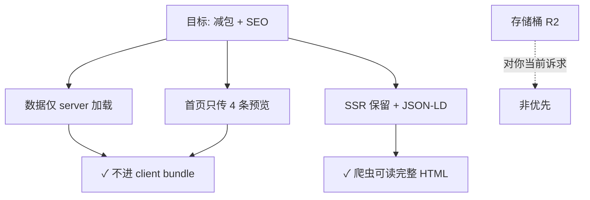

你的直觉有一半是对的：这个文件**不是**什么 cache handler、中间件或类，也**不会**自动给响应加缓存头。

## 它到底是什么

就是一个放**预设 HTTP 响应头常量**的小文件：

```1:17:app/lib/cache-headers.server.ts
export const NO_STORE_HEADERS = {
  "Cache-Control": "no-cache, no-store, must-revalidate",
} as const;

export const JSON_NO_STORE_HEADERS = {
  ...NO_STORE_HEADERS,
  "Content-Type": "application/json",
} as const;

export const TOKEN_DATA_CACHE_HEADERS = {
  "Cache-Control": "public, max-age=300",
} as const;

export const JSON_TOKEN_DATA_CACHE_HEADERS = {
  ...TOKEN_DATA_CACHE_HEADERS,
  "Content-Type": "application/json",
} as const;
```

一共 4 组：

| 常量 | 含义 |
|------|------|
| `NO_STORE_HEADERS` | 禁止缓存（敏感/动态数据） |
| `JSON_NO_STORE_HEADERS` | 同上 + `Content-Type: application/json` |
| `TOKEN_DATA_CACHE_HEADERS` | 公开缓存 5 分钟（`max-age=300`） |
| `JSON_TOKEN_DATA_CACHE_HEADERS` | 同上 + JSON |

`.server.ts` 只是 Remix 约定，表示**只在服务端用**；里面没有函数、没有逻辑，就是几个对象。

## 缓存策略还是在各路由里决定的

你说「控制缓存不应该写在具体函数里吗」——**正是这样用的**。这个文件只提供可复用的字符串，真正决定用哪套头的，还是每个 loader/action，例如：

```28:30:app/routes/game.tsx
  return json(await buildGamePlatformData(platformId, currentPage), {
    headers: JSON_TOKEN_DATA_CACHE_HEADERS,
  });
```

```24:32:app/routes/api.verify-token.tsx
    return json<VerifyTokenResponse>(
      { 
        valid: false, 
        error: 'Token and image name are required' 
      },
      { 
        status: 400,
        headers: NO_STORE_HEADERS
      }
    );
```

成功时还会按 token 剩余时间**内联**写一套不同的头：

```66:70:app/routes/api.verify-token.tsx
        headers: {
          // 验证成功可以短时间缓存，但不超过token剩余时间
          "Cache-Control": `public, max-age=${cacheTime}, s-maxage=${cacheTime}`,
          "Content-Type": "application/json",
        }
```

所以：**策略在各路由；这个文件只是避免重复写同一段 header 字符串。**

## 有没有在用

有，被 **10 个路由**引用：

- **禁止缓存**：`api.claim-token`、`api.nemesis`、`api.nemesis-feedback`、`api.image-token`、`api.verify-token`（错误分支）、`auth.sign-out`
- **5 分钟 token 数据缓存**：`cv`、`xiao`、`game`、`game.$platform`

不是死代码，删掉这些 import 会编译失败。

## 为什么看起来「诡异」

主要是**用法不统一**，不像「所有缓存都抽象到一个地方」：

1. **只抽了一部分**  
   很多路由仍内联 `Cache-Control`，例如：
   - `music.tsx`：`max-age=3600`（1 小时）
   - `anime.tsx`：`max-age=300, stale-while-revalidate=600`
   - `gallery.tsx`、`updates.tsx`、`sitemap.xml` 等各自一套

2. **命名和实际不完全一致**  
   `TOKEN_DATA_CACHE_HEADERS` 是 300 秒，但 `music.tsx` 注释写「token 数据缓存 1 小时」，用的是 3600 秒，没走这个常量。

3. **同一文件混用常量和内联**  
   `api.image-token.tsx` 错误用 `NO_STORE_HEADERS`，成功路径自己写 `private, max-age=60` / `public, max-age=3600`。

4. **不是框架机制**  
   不会自动生效；每个 `return json(...)` 要自己传 `headers`，漏传就没有这些头。

## 结论

| 问题 | 答案 |
|------|------|
| 是 cache handler 吗？ | **不是**，只是 header 常量 |
| 有用吗？ | **有用**，给 token/API/登出等重复场景做 DRY |
| 是完整缓存抽象吗？ | **不是**，项目里大量缓存仍写在各路由里 |
| 该不该删？ | **不建议删**，除非把引用处改回内联 |

更贴切的理解：**共享的 header 配方表**，不是缓存控制中心。如果你觉得乱，可以：

- **保留**：继续给「禁止缓存」和「5 分钟 token 页」用；
- **或扩展**：把 `music`、`anime` 等同策略也收进来，并统一命名（例如 `PUBLIC_1H_HEADERS`）；
- **或收缩**：觉得常量太少、反而增加跳转，可以只在 API 层保留 `NO_STORE_*`，页面级继续内联。

需要的话我可以帮你扫一遍全项目，列一张「哪些路由该用常量、哪些该内联」的对照表。
你的判断是对的：**游戏平台确实走了和 Gallery 同一套 token 流程**，但对游戏封面来说，这套保护多半是**历史/架构惯性**，不是业务上真的需要。

## 两套页面用的是同一套管道

`game-platform.server.ts` 里：

```13:34:app/lib/game-platform.server.ts
  const tokenMap = await getMediaTokenMap([
    "game/jkl.jpg",
    ...paginationResult.paginatedGames.map((game) => game.cover),
    ...followedGames.map((game) => game.cover),
  ]);

  return {
    // ...
    paginatedGames: paginationResult.paginatedGames.map((game) => ({
      ...game,
      cover: tokenizedSrc(game.cover, tokenMap),
    })),
    // ...
    avatarImageUrl: tokenizedSrc("game/jkl.jpg", tokenMap),
  };
```

Gallery 也是同一套：`getMediaTokenMap` → `withTokenizedSrc` / `tokenizedSrc`。

最终 URL 都会变成类似：

```
/api/media?imageName=game/pox.jpg&token=xxxx
```

`/api/media` 会校验 HMAC token，再从 R2 的 `MEDIA_BUCKET` 里取文件：

```31:34:app/routes/api.media.tsx
  const verification = await verifyImageToken(token, normalizedImageName);
  if (!verification.valid) {
    return new Response(verification.error || "Invalid token", { status: 401 });
  }
```

所以：**不是「游戏页单独一套逻辑」，而是和 Gallery、music、cv、xiao 共用同一套 R2 + token 网关。**

## 为什么 Gallery 需要 token

Gallery 存的是你自己的照片（`/photos/*.webp`），页面文案也写了不想被微信压缩、也不想随便被外链：

> 所以你在这里能看见一些我从未分享过的照片。

对这类资源，token 的意义是：

- 图片在 R2，不挂在 `public/` 下，不能直接猜 URL 访问
- 带过期时间的签名 URL，降低被批量爬、长期热链的风险

这里 token 是**有意做的访问控制**。

## 游戏平台为什么不需要（但当前仍被保护了）

`gameData.ts` 里的封面路径是 `game/pox.jpg`、`game/ring.jpg` 这类，同样存在 R2，同样走 token 网关。但你说得对：

- 这些都是公开的游戏封面/宣传图
- 没有隐私或版权上的「必须藏」需求
- 互联网上本来就能找到同款图

当前给游戏图加 token，更像是：

**所有 R2 媒体都统一走 `/api/media`，游戏图被顺带套进了同一套机制**，而不是因为游戏页有特殊安全需求。

## 带来的实际代价

对游戏页来说，token 主要是**多余复杂度**：

| 方面 | 影响 |
|------|------|
| Loader | 每次要 `getMediaTokenMap`，批量算 HMAC |
| 缓存 | token 约 30 分钟过期，页面缓存只能设短（game 用 `max-age=300`） |
| URL | 带 `token` 参数，不利于长期 CDN 缓存 |
| 维护 | 和 Gallery 绑在同一套逻辑里，容易误以为「游戏图也要保护」 |

## 更合理的做法（如果要去掉 token）

按公开程度，从简单到稍复杂：

**1. 放到 `public/game/`（最省事）**

- `gameData` 里封面改成 `/game/pox.jpg`
- `game-platform.server.ts` 删掉 `getMediaTokenMap` / `tokenizedSrc`
- Cloudflare/Pages 静态资源长缓存，零 token 逻辑

**2. Worker 里给 `game/*` 开公开路由（和字体类似）**

`worker.ts` 里 `/fonts/` 已经从 R2 **无 token** 直出：

```67:78:worker.ts
    if (!isLocalRequest && request.method === "GET" && url.pathname.startsWith("/fonts/")) {
      const fontKey = url.pathname.replace(/^\/fonts\//, "fonts/");
      const object = await env.MEDIA_BUCKET?.get(fontKey);
      // ... 直接返回，无 token
```

可以对 `/game/*` 做同样的事，图片继续放 R2，但 URL 变成 `/game/pox.jpg`，不用 token。

**3. `/api/media` 按路径前缀分流**

例如 `game/*` 免 token 直出，`photos/*` 仍要 token。灵活，但 `/api/media` 会多一层分支逻辑。

---

## 结论

| 问题 | 答案 |
|------|------|
| 游戏平台和 Gallery token 逻辑一致吗？ | **是**，共用 `media-token.server.ts` + `/api/media` |
| 游戏图需要这种保护吗？ | **不需要**，公开封面没必要 |
| 为什么现在还有？ | 游戏图也在 R2，走了统一的 token 网关，不是单独为游戏设计的 |
| 该不该改？ | 若你确认游戏图都可公开，**建议去掉**；Gallery / 私人照片继续保留 token |

如果你愿意改，我建议走 **方案 1（`public/game/`）或方案 2（Worker 公开路由）**；说一声你更倾向哪种，我可以直接帮你改 `game-platform.server.ts` 和相关路由。
你的判断基本是对的。结合当前代码，我的看法如下。

## 结论：对个人站来说，Magic Link 可以去掉

Google + Microsoft + One Tap 已经是一条完整、清晰的登录路径。Magic Link 在这里更像是「Better Auth 常见模板」带来的第三条路，而不是你产品真正需要的功能。

---

## 为什么 Magic Link 在这里显得多余

**1. 和 OAuth 解决的是同一类问题**

对个人站访客来说，「无密码登录」Google / Microsoft 已经做到了。One Tap 还把 Google 的摩擦降到了几乎为零。Magic Link 仍然是：填邮箱 → 等邮件 → 开收件箱 → 点链接，步骤更多，体验和 OAuth 不在一个层级。

**2. 和视觉叙事冲突**

`LoginPanel` 里 OAuth 是「快速进入」，Magic Link 是「寄登录信 / Letter dispatched / or send a letter」。两套隐喻叠在一起，登录页像在说两件事：

- 官方账号一键进
- 又像复古邮局寄信

你已经有 Google / Microsoft 两个官方渠道，再加邮箱登录信，信息架构会变散，用户也会犹豫该点哪个。

**3. 维护成本不低，收益却小**

Magic Link 不只占 `email.server.ts` 一半左右，还牵了一串东西：

| 位置 | 作用 |
|------|------|
| `auth.server.ts` | `magicLink` 插件 + 三层限流 |
| `api.auth.$.ts` | IP 限流 |
| `rate-limit.server.ts` | `MagicLinkRateLimitService` |
| `auth-client.client.ts` | `magicLinkClient` |
| `LoginPanel.tsx` | 表单、倒计时、成功页文案 |

对个人站，这套链路偏重；真正会走邮箱登录的用户通常很少。

**4. 邮件能力仍然需要，但不必为登录保留**

`email.server.ts` 里 `sendMessageNotificationEmail`（留言通知管理员）是有实际价值的，和登录无关。精简时应该删 Magic Link 相关，保留通知邮件。

---

## 什么情况下才值得保留 Magic Link

只有在你明确需要下面某一类用户时，才值得留着：

- 坚决不用 Google / Microsoft 的人
- 企业邮箱用户（只有邮箱、没有常用 OAuth）
- OAuth 出问题时给管理员的备用入口

对你这种个人站，这三类都偏边缘。若真担心 OAuth 挂掉，更实际的是你自己保留一个 admin 后门或本地 session，而不是给所有访客开放 Magic Link。

---

## 去掉之后登录页可以怎么变

会更干净，也更一致：

```
继续进入这片空间
[ Google ]  [ Microsoft ]
登录即表示你同意服务条款和隐私政策
```

文案可以从「三种方式任选」改成「选择你的账号进入」。One Tap 继续在合适页面静默出现，不必在面板里再提邮箱。

删掉 Magic Link 后，可以顺手去掉：

- 「寄出登录信」表单和成功态
- 倒计时、邮件发送失败等错误态
- `Private passage` / `or send a letter` 这套邮局隐喻（除非你想保留纯装饰文案）

登录页会短一截，认知负担也更低。

---

## 关于 `email.server.ts` 的精简方向

不是整文件删掉，而是拆成「只服务业务通知」：

- **删除**：`sendMagicLinkEmail`、`getEmailTemplate`（紫色渐变那套登录邮件）
- **保留**：`sendMessageNotificationEmail`、共用配置（`getEmailRuntimeConfig`）、`escapeHtml` 等工具函数
- **可选**：两个发信函数若结构类似，可抽一个小的 `sendEmail({ to, subject, html, idempotencyKey })`，但不必过度抽象

文件大概能从 420 行减到 200 行左右，职责也更清楚：**邮件 = 站内业务通知，不是登录通道**。

---

## 一个小提醒

若库里已有纯 Magic Link 注册、没有绑定 Google/Microsoft 的账号，去掉插件后这些人无法再登录。对个人站通常可以接受；若担心，可以先查一下 `account` 表里是否只有 `credential` / magic link、没有 `google` / `microsoft` provider 的用户。

---

**总结**：两个官方 OAuth + One Tap 对个人站已经足够，Magic Link 在体验、视觉和代码上都是额外负担。`email.server.ts` 应精简为「留言等业务通知」，而不是登录基础设施。

你确认要走这条路的话，我可以按「删 Magic Link、保留留言通知邮件、简化 LoginPanel」给你列一版具体改动清单（仍先不动代码，或你点头后直接改）。
你的判断基本对：`app/lib/types.ts` 像是早期脚手架留下的「万能类型桶」，而近一个月的实际开发已经把领域类型拆出去了，这个文件几乎没人再碰。

## 结论概览

| 分类 | 数量 | 说明 |
|------|------|------|
| **完全未引用** | ~40 个 export | 全项目没有任何 `import` |
| **名义在用、但已过时** | 3 个 | `AppOutletContext`、`BetterAuthUser`、`BetterAuthSession` |
| **写了但从未接上** | 6 个 | 音乐/游戏相关，各路由自己内联了结构 |
| **真正在用的** | 仅 1 处 | `Header.tsx` 引了 `AppOutletContext` |

全项目里，**只有** `app/components/ui/Header.tsx` 从 `~/lib/types` 导入类型：

```4:4:app/components/ui/Header.tsx
import type { AppOutletContext } from '~/lib/types';
```

游戏类型已经迁到独立文件，且正在被使用：

```5:5:app/lib/data/gameData.ts
import type { Game, Platform, UserStat, FollowedGame, AllGamesData } from "~/lib/types/game";
```

---

## 一、完全没用到的（可删）

下面这些 export 在 `app/` 下**零引用**（只在 `types.ts` 自身或 `types.ts.backup` 里出现）：

**基础 / 用户 / 认证脚手架**
- `ID`, `Status`, `Theme`, `Language`
- `User`, `UserRole`, `UserPreferences`, `NotificationSettings`, `PrivacySettings`
- `AuthState`, `LoginCredentials`, `RegisterData`

**API / 分页**
- `ApiResponse`, `ApiError`, `PaginationParams`, `PaginatedResponse`

**表单 / 组件 props 模板**
- `FormField`, `ValidationRule`, `SelectOption`, `FormState`
- `ComponentProps`, `ButtonProps`, `ModalProps`, `ToastProps`

**路由 / 博客 CMS 模板**
- `RouteParams`, `SearchParams`
- `BaseEntity`, `Post`, `Comment`

**工具类型**
- `Optional`, `RequiredFields`, `DeepPartial`, `Nullable`, `ValueOf`, `Json`

**写了但从未 import 的领域类型**
- `GamePlatform` — 已被 `~/lib/types/game.ts` 的 `Platform` / `PlatformId` 替代
- `DnaImage`, `Album`, `Lyric`, `TopSong`, `TimelineItem` — 各页面内联定义，没接上

例如 `music.tsx` 直接写对象，没用 `types.ts` 里的 `Album`（那边是 `title + cover`，实际是 `src + alt`）：

```40:45:app/routes/music.tsx
  const rawAlbums = [
    { id: 1, src: '/SVG/n.jpg', alt: 'FELT Album 1 Cover' },
    { id: 2, src: '/SVG/t.jpg', alt: 'FELT Album 2 Cover' },
    ...
  ];
```

`cyber-terminal.tsx` 也自己定义了同名但结构完全不同的 `TimelineItem`（有 `category`、`status`，不是 types.ts 里的 `year/genre/artist`）。

另外还有 `types.ts.backup`，内容和主文件几乎一样，也是死文件。

---

## 二、名义在用、但已经过时

### `AppOutletContext` + `BetterAuthSession` + `BetterAuthUser`

`Header` 确实在用 `AppOutletContext`，但类型和真实数据已经对不上了。

**真实 session 类型**在 `auth.server.ts` 里，叫 `PublicSession`（未 export）：

```231:243:app/lib/auth.server.ts
type PublicSession = {
  user: {
    id: string;
    email: string;
    name?: string | null;
    image?: string | null;
    emailVerified?: boolean;
    role?: string | null;
    banned?: boolean | null;
    banReason?: string | null;
    banExpires?: Date | string | number | null;
  };
};
```

`root.tsx` loader 通过 `toPublicSession()` 下发的就是这个结构，**不是** `types.ts` 里的 `BetterAuthSession`。

对比差异：

| 字段 | `types.ts` 的 `BetterAuthUser` | 实际 `PublicSession.user` |
|------|-------------------------------|---------------------------|
| `createdAt` / `updatedAt` | 有，且为 `Date` | 无 |
| `role` | 无 | 有 |
| `name` / `image` | `string?` | `string \| null` |
| `emailVerified` | 必填 `boolean` | 可选 |

`AppOutletContext` 里还声明了 `loginDialogOpen`，但 `Header` 只解构了 `session` 和 `openLoginDialog`，没用到 `loginDialogOpen`。

所以这三个类型属于「挂着名字、结构和现状不符」，TypeScript 目前没报错主要是因为两边都偏宽松，并不是类型真的对齐了。

### `Theme` 重复且冲突

- `types.ts`: `'light' | 'dark' | 'system'`
- `app/utils/theme.server.ts`: `'light' | 'dark'`（项目实际在用）

`types.ts` 里的 `Theme` 完全没被引用，还和新实现不一致。

---

## 三、建议怎么处理

**最小改动（推荐）**：把 `types.ts` 收成只保留 outlet 相关，并跟 `auth.server.ts` 对齐：

```ts
// app/lib/types.ts — 精简后示意
import type { SerializeFrom } from "@remix-run/cloudflare";
import type { loader } from "~/root";

export type AppOutletContext = {
  session: SerializeFrom<typeof loader>["session"];
  openLoginDialog: () => void;
  loginDialogOpen: boolean;
};
```

或者把 `PublicSession` 从 `auth.server.ts` export 出来，在这里复用。

**彻底清理**：删掉第 1 节列出的所有死类型 + `types.ts.backup`；音乐页如需类型，在 `app/lib/types/music.ts` 按 `music.tsx` 真实结构新建（`src` 不是 `cover`）。

**不要做的事**：别把 `types/game.ts` 合并回 `types.ts`——那边已经是正确、在用的拆分方式。

---

## 总结

`types.ts` 里大约 **95% 是早期模板代码**，一个月来的改动都没经过这里；真正还在用的只有 `AppOutletContext` 这一条线，而且 session 类型已经落后于 `auth.server.ts` 的 `PublicSession`。

如果你愿意，我可以直接帮你做一版精简：删掉死代码、修正 `AppOutletContext`，并顺手删掉 `types.ts.backup`。
你的理解大体对：**Changelog / Release Notes / Updates** 都是指同一类东西——对外公开的版本更新记录。你们现在的实现和「主流」相比，属于其中一种常见做法，但还不是「放存储桶里读 MD」那种。

## 你们现在是怎么做的

`updates.tsx` 的 loader 并不是从存储桶拉数据，而是从本地 TypeScript 数据源读取：

```26:35:app/routes/updates.tsx
export async function loader() {
  const data: UpdatesPageData = {
    updates: getSortedUpdates(),
  };

  return json(data, {
    headers: {
      'Cache-Control': 'public, max-age=3600, s-maxage=3600',
    }
  });
}
```

数据在 `app/data/updates.ts` 里，是结构化的 `UpdateLog[]`（version、date、type、title、items 等），本质上是 **代码仓库里的 JSON/TS 数据**，和 Git 一起版本管理。

首页的 `changelog-section.tsx` 也复用同一套数据。

---

## 2025–2026 主流做法（按场景）

### 1. 开源库 / 开发者工具：**Docs-as-Code + Markdown**

最常见的是仓库根目录的 `CHANGELOG.md`，遵循 [Keep a Changelog](https://keepachangelog.com/) 规范：

- 最新版本在最上面
- 日期用 ISO 8601（`2026-06-04`）
- 分类：`Added` / `Changed` / `Fixed` / `Removed` / `Deprecated`
- 和代码同 PR 维护，不单独维护一份

适合：npm 包、CLI、API 文档站。  
不太适合：你们这种带目录、标签、动画的精美产品页（MD 要再解析一层）。

### 2. SaaS / 产品站：**结构化数据 + 公开页面**（你们更接近这类）

主流要求是：

| 能力 | 说明 |
|------|------|
| 公开 URL | `/updates`、`/changelog` 等，SSR 利于 SEO |
| 单条可锚点 | 每条有永久链接，方便客服、邮件引用 |
| 分类标签 | feature / fix / breaking 等 |
| 单一数据源 | 不要网站、GitHub、Notion 各维护一份 |
| 可选分发 | RSS、JSON API、邮件订阅、应用内 widget |

数据存放方式常见有：

- **TS/JSON 在仓库里**（你们现在）—— 小团队、更新不频繁时很常见
- **Headless CMS**（Sanity、Contentful）—— 非技术人员也要写 changelog 时
- **专用 SaaS**（ReleasePad、changelog.dev 等）—— 要订阅、邮件、in-app 通知时
- **Git 里的 MD + CI 构建**—— 写 MD，构建时转成页面数据

### 3. 存储桶（R2 / S3）放 MD 或 JSON？

**有，但不是最主流的第一选择**，更多用在：

- 把 changelog 当 **静态资源/API** 分发（例如 `changelog.json` 给客户端、widget、AI 工具读）
- 多环境、多产品共用同一份远程配置
- 不想每次改 changelog 都重新 deploy 整个站点

典型形态：

```
https://cdn.example.com/changelog.json     → 机器读
https://cdn.example.com/releases/v1.30.md  → 单条详情
https://example.com/changelog?format=md    → 同内容 Markdown 变体（部分 SaaS 支持）
```

较新的趋势（如 [structured-changelog](https://github.com/grokify/structured-changelog)）是：

- **JSON 为 canonical 源**（机器可读、可校验）
- **Markdown 由 JSON 生成**（给人看）
- 而不是反过来只维护 MD

### 4. 自动化生成（偏工程团队）

- Conventional Commits + `semantic-release` / `git-cliff` 从 commit 生成草稿
- 公开 changelog 仍要 **人工润色**（技术 commit 不适合直接给用户看）

---

## 和你们项目的对照

你们当前方案：

```
app/data/updates.ts (结构化 TS)
        ↓
loader → /updates 页面
        ↓
changelog-section 首页预览
```

优点：

- 类型安全、和 Remix loader 契合
- 无额外基础设施
- 已有 `type`、锚点、目录等自定义 UI 字段

若改成「存储桶 + MD/JSON」，通常是为了：

- 改 changelog **不用重新 deploy**
- 运营/非开发在后台写
- 多端共用同一份 JSON（Web + App + RSS）

对你们这种个人站/产品站，**继续用仓库内结构化数据完全合理**；存储桶更适合「更新很频繁」或「多人协作写内容」的阶段。

---

## 若以后要升级，常见演进路径

```mermaid
flowchart LR
  A[现在: app/data/updates.ts] --> B[CHANGELOG.md + 构建脚本解析]
  A --> C[R2 上 changelog.json + loader fetch]
  A --> D[Headless CMS / 专用 Changelog SaaS]
  B --> E[/updates 页面]
  C --> E
  D --> E
```

1. **小改**：保留 TS，同时导出 `public/changelog.json` 或 RSS（给订阅/SEO）
2. **中等**：`content/releases/*.md` + frontmatter，构建时生成 `updates.ts` 或 loader 直接读
3. **Cloudflare 原生**：R2 放 `changelog.json`，loader 里 `fetch` + `Cache-Control`（和你们现在缓存策略一致）
4. **重度运营**：Sanity / 专用 changelog 工具

---

**结论**：  
- 叫 **changelog / release notes / updates** 都对，产品页多用 changelog 或 updates。  
- **不是**「主流一定放存储桶」；更主流的是 **单一数据源 + 公开 SSR 页面**。  
- 存储桶里的 MD/JSON 是 **分发/API 层** 的一种做法，不是唯一标准。  
- 你们现在的 **仓库内结构化 TS 数据** 是合法且常见的一种，尤其适合自定义 UI 和 Cloudflare Remix。

如果你打算迁到 R2 或 MD 文件，可以说一下更在意「不改代码就能更新」还是「写作体验」，我可以按你们现有 `UpdateLog` 结构给一版具体方案（含 loader 怎么改）。
按你的目标（**性能 / 减包 / SEO**），结论可以收得很明确：

## 核心判断：不必上存储桶

对你这种体量的个人站，**把 changelog 放到 R2/S3 里读 MD 或 JSON，通常不会更快，也不一定更利于 SEO**。

| 方案 | 包体积 | 性能 | SEO |
|------|--------|------|-----|
| 现在：`updates.ts` 被首页组件直接 import | 差 — 约 24KB 原文会进首页 JS | 一般 | `/updates` SSR 还行 |
| `updates.server.ts` / loader 只服务端读 | 好 — 首页零 changelog 数据 | 好 — 无额外网络请求 | 好 — 仍是 SSR HTML |
| R2 里放 JSON/MD，loader 每次 fetch | 好 — 不进 bundle | 差 — 多一次 R2 延迟 | 一样 — 还是 SSR 渲染 |
| `public/changelog.json` + 客户端 fetch | 中 | 差 — 客户端请求 + 无首屏内容 | 差 — 爬虫可能看不到 |

**存储桶更适合**：多端共用、运营后台改内容、不想 redeploy。  
你的诉求是性能和 SEO，**继续放仓库里，但改成「仅服务端加载」** 是最划算的。

---

## 现在最大的包体积问题

问题不在 `/updates` 页面，而在**首页**：

```3:10:app/components/changelog-section.tsx
import { formatUpdatePreviewDate, getSortedUpdates } from "~/data/updates"

const entries = getSortedUpdates().slice(0, 4).map((update) => ({
  version: update.version,
  date: formatUpdatePreviewDate(update.date),
  description: update.title,
}))
```

`changelog-section` 在模块顶层 import 了整份 `updates.ts`（32 条完整记录），首页只需要 4 条预览，却把全部 changelog 打进了客户端 bundle。

`/updates` 的 loader 本来就是服务端跑，SEO 没问题；**首页才是浪费**。

---

## 推荐方案（按收益排序）

### 1. 服务端隔离数据（必做，收益最大）

```
app/data/updates.json          ← 纯数据，好维护
app/data/updates.server.ts     ← getSortedUpdates()，仅 server import
app/data/updates.ts            ← 只留 type + format 函数（极小）
```

- `_index` loader：只传 `slice(0, 4)` 给 `ChangelogSection`
- `updates.tsx` loader：从 `.server.ts` 读全量
- `changelog-section`：改成接收 props，不再 import 数据

**效果**：首页 JS 减掉约 20KB+ 的 changelog 数据，改动小、无新基础设施。

### 2. SEO 增强（低成本、效果明显）

你现在 `/updates` 只有静态 meta，还可以加：

1. **动态 description** — 带上最新版本，例如：`最新 v1.30.0（2026-06-04）：主站动效与字体统一…`
2. **JSON-LD** — `ItemList` + 每条 `BlogPosting` / `SoftwareSourceCode`，方便 Google 理解更新条目
3. **Sitemap `lastmod`** — 从最新 changelog 日期自动生成，别手写 `2025-11-15`
4. **可选 RSS** — `/updates/rss.xml`，对 SEO 帮助有限，但对订阅和爬虫友好

这些**不需要存储桶**，loader 里生成即可。

### 3. 不建议为了性能做的事

- 把 MD 放 R2 运行时解析 — 增加 CPU + 延迟
- 首页客户端 fetch changelog — 伤首屏和 SEO
- 单独 changelog SaaS — 多一跳、多依赖，对你场景过重

---

## 和你目标的对应关系



---

## 建议落地顺序

1. 拆 `updates.server.ts` + 首页 loader 传 props（半天内可完成，包体积立刻下降）
2. `/updates` 加 JSON-LD + 动态 meta（SEO 提升）
3. sitemap `lastmod` 跟最新 release 联动

如果你愿意，我可以直接按上面第 1、2 步改代码：不动 R2，只动数据分层和 SEO，改动面很小。
**不能直接删。** `request.server.ts` 还在用，只是用途从「展示/获取用户 IP」变成了 **IP 限流**。

## 文件内容

`app/utils/request.server.ts` 导出 3 个函数：

| 函数 | 状态 |
|------|------|
| `getClientIP` | **仍在使用** |
| `getUserAgent` | 未被引用 |
| `isMobileDevice` | 未被引用 |

## 仍在引用 `getClientIP` 的地方

**1. 留言板 IP 限流** — `app/lib/messages.server.ts`

```91:107:app/lib/messages.server.ts
  const clientIP = getClientIP(request);
  console.log("[Message] Submission attempt:", {
    userId: user.id,
    username: user.name || user.email,
    ip: clientIP,
    timestamp: new Date().toISOString(),
  });

  const ipAllowed = await RateLimitService.checkIPRateLimit(clientIP);
  if (!ipAllowed) {
    console.warn("[RateLimit] IP blocked:", { ip: clientIP, userId: user.id });
    return {
      ok: false as const,
      status: 429,
      payload: { error: "操作过于频繁，请一小时后再试（IP 限制：20次/小时）" },
    };
  }
```

**2. Magic Link 登录 IP 限流** — `app/routes/api.auth.$.ts`

```24:50:app/routes/api.auth.$.ts
  if (isMagicLinkRequest) {
    const clientIP = getClientIP(request);
    // ...
    const ipCheck = await MagicLinkRateLimitService.checkIPRateLimit(clientIP);
    if (!ipCheck.allowed) {
      return json(
        { error: "请求过于频繁，请稍后再试", ... },
        { status: 429 }
      );
    }
  }
```

底层限流逻辑在 `app/lib/rate-limit.server.ts` 的 `checkIPRateLimit`。

## 结论

- **不能单独删** `request.server.ts`，否则上面两处会编译失败。
- 如果你确定 **不再需要 IP 限流**，需要一起改：
  1. 删 `app/utils/request.server.ts`
  2. 去掉 `messages.server.ts` 里的 IP 检查
  3. 去掉 `api.auth.$.ts` 里的 Magic Link IP 检查
  4. 视情况清理 `rate-limit.server.ts` 里对应的 IP 限流逻辑

- 如果只是觉得「获取别人 IP 展示给用户」那个需求没了：**这个文件可以保留**，它现在主要是防刷/防滥用，不是给用户看的。

- `getUserAgent` 和 `isMobileDevice` 确实是死代码，可以安全删掉；或者保留 `getClientIP`，把另外两个未使用的函数去掉。

你是想 **彻底去掉 IP 限流**，还是 **只清理未使用的函数**？我可以按你的选择直接改。
你的直觉有一半是对的，但不必把「集中在一个 utils 文件」和「给机器人看」对立起来。

## 机器人实际读的是什么？

爬虫读的是最终 HTML 里的 `<title>`、`<meta>`、`<link rel="canonical">` 等，不关心这些标签是在哪个 `.ts` 文件里写的。

在 Remix 里，真正对外生效的是**每个路由**导出的 `meta`：

```66:68:app/routes/_index.tsx
export const meta: MetaFunction = () => {
  return pageMeta.home();
};
```

```36:36:app/routes/gallery.tsx
export const meta: MetaFunction = () => pageMeta.gallery();
```

`seo.ts` 只是生成 `MetaDescriptor[]` 的工具，最终 meta 仍然挂在各自路由上，SSR 时进 `<head>`，机器人能读到。

## `seo.ts` 里什么合理、什么别扭

**合理的是 `generateMeta()`** —— 把重复样板集中处理：

- `og:*`、Twitter Card、canonical
- 站点名拼接（`标题 | 汪家俊的个人网站`）
- 默认 OG 图、locale 等

这些放 utils 很常见，避免每个路由复制十几行相同结构。

**别扭的是 `pageMeta` 对象** —— 各页的 title、description、keywords 都堆在一个文件里：

```78:95:app/utils/seo.ts
export const pageMeta = {
  home: () =>
    generateMeta({
      title: "汪家俊的个人网站 - 将我的爱弃置于此",
      description: "欢迎来到汪家俊...",
      url: "https://xn--cckl9nsb.com",
      ...
    }),

  gallery: () =>
    generateMeta({
      title: "摄影作品集",
      ...
    }),
```

这和 Remix 常见写法不太一致：**页面专属的 SEO 文案，通常就写在对应路由的 `meta` 里**（或从该路由的 `loader` 数据推导），改 gallery 时不用跳到 `utils/seo.ts`。

项目里也能看到不一致：有的路由用 `pageMeta`，有的自己写 meta：

- `game.tsx`、`xiao.tsx`、`rapid-layers-preview.tsx` — 路由内直接写
- `game.$platform.tsx` — 用 loader 数据动态生成

## 更清晰的结构建议

```
app/utils/seo.ts          → 只保留 generateMeta() + 站点级常量
app/routes/gallery.tsx    → export const meta = () => generateMeta({ title: "...", ... })
app/routes/cv.tsx         → 同上，文案就在 cv 路由旁边
```

动态页（如 `game.$platform.tsx`）用 loader 数据：

```ts
export const meta: MetaFunction<typeof loader> = ({ data }) =>
  generateMeta({
    title: data.platformName,
    description: `...`,
    url: `https://xn--cckl9nsb.com/game/${data.slug}`,
  });
```

## 小结

| 层面 | 现状 | 建议 |
|------|------|------|
| 爬虫能否读到 | 能，meta 在各路由导出 | 不用改机制 |
| `generateMeta` 工具函数 | 合理 | 保留 |
| `pageMeta` 集中注册 | 内容和页面分离，难维护 | 拆回各路由的 `meta` |

所以：**SEO 本来就应该在具体路由里「声明」**；`seo.ts` 适合做**生成器**，不适合做**所有页面的文案仓库**。如果你愿意，我可以帮你把 `pageMeta` 拆回各路由，只保留 `generateMeta`。